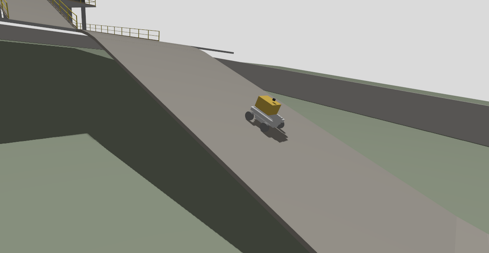
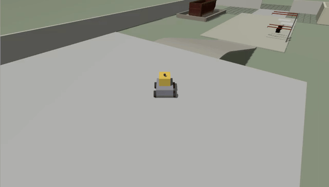
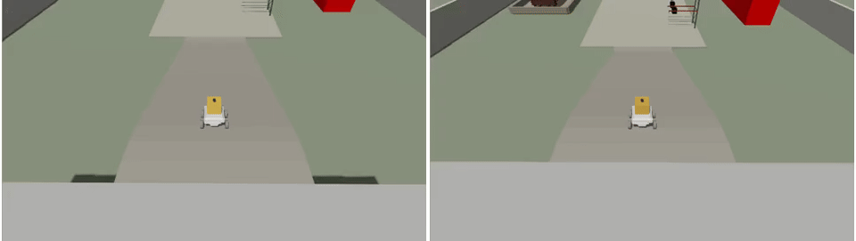
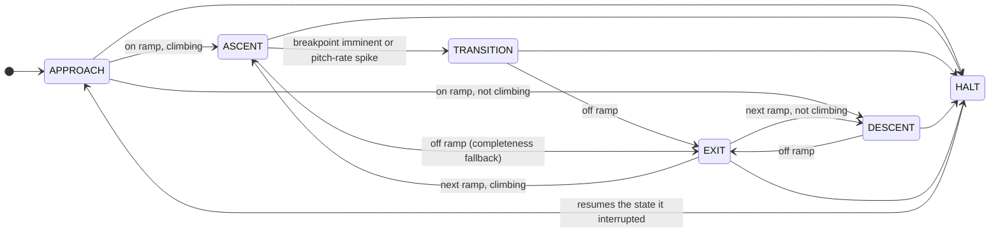
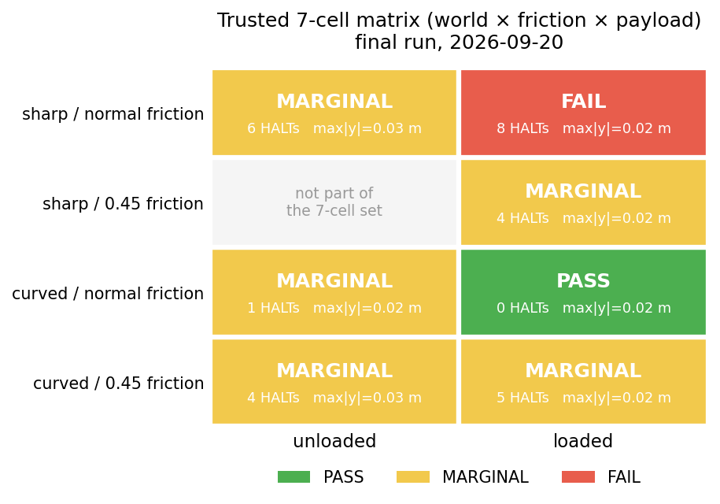
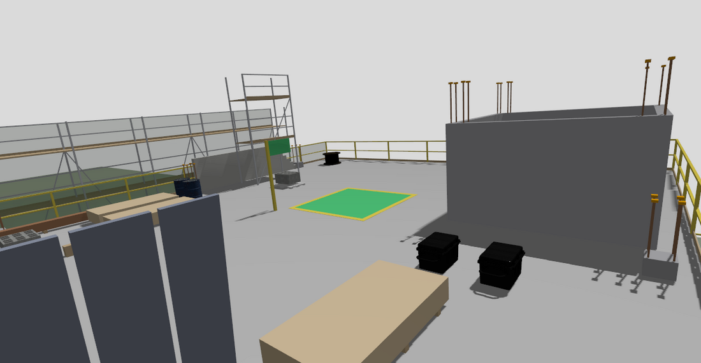
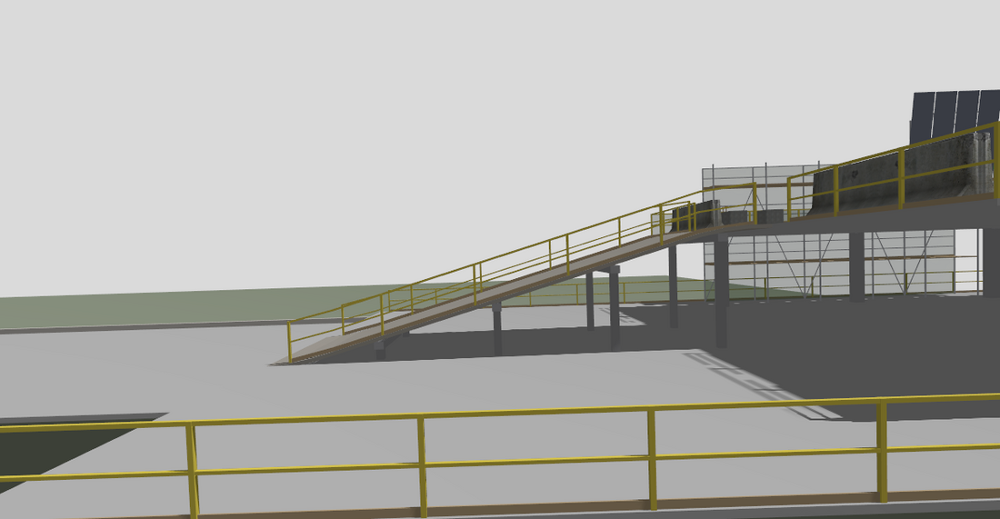
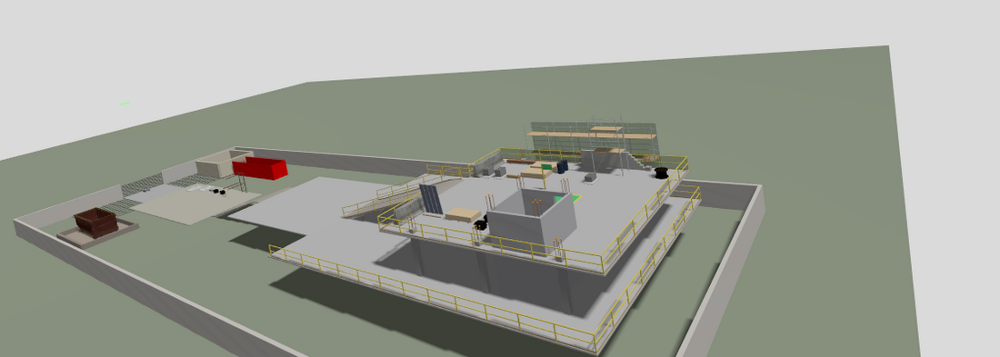

<div align="center">

# Ramp Autonomy

### Ramp ascent and descent for a *loaded* wheeled AMR — the part flat-floor navigation quietly gets wrong

[](https://github.com/skunal3318/Ramp-Autonomy/actions/workflows/checks.yml)
[](https://docs.ros.org/en/jazzy/)
[](https://gazebosim.org/)
[](https://docs.nav2.org/)
[](LICENSE)
[](CONTRIBUTING.md)



**[See it run](#-see-it-run) · [The problem](#-the-problem) · [How it works](#-how-it-works) · [Results](#-results) · [Four findings](#-four-findings-worth-your-time) · [Quickstart](#-quickstart)**

</div>

---

Construction-site AMRs — the kind that move material between floors — cross temporary ramps constantly. Almost all published navigation work,
standard Nav2/MPPI tuning included, assumes flat ground. **This project treats the ramp as its own control and safety problem** rather than
something a flat-floor planner should power through.

It is a simulation project, deliberately. Everything below is a Gazebo result, and sim-to-real is an explicit separate phase, not something
quietly deferred — see [`docs/roadmap.md`](docs/roadmap.md).

> [!NOTE]
> **This README reports failures alongside passes on purpose.** The trusted matrix is 1 PASS, 5 MARGINAL, 1 FAIL — and the four findings below
> are all cases where the *first* convincing explanation turned out to be wrong. If you are evaluating whether to trust this code, the
> [retrospective](docs/retrospective.md) is a better read than any benchmark table.

<table>
<tr><td width="33%" valign="top">

**🎥 Want to watch it?**

Jump to [See it run](#-see-it-run) for full round-trip captures.

</td><td width="33%" valign="top">

**🔧 Want to run it?**

[Quickstart](#-quickstart) is three commands, then
[`docs/getting-started.md`](docs/getting-started.md).

</td><td width="33%" valign="top">

**🔬 Want to judge the work?**

[`docs/retrospective.md`](docs/retrospective.md) and
[`docs/validation-methodology.md`](docs/validation-methodology.md).

</td></tr>
</table>

---

## 🎥 See it run

Full Gazebo GUI captures with the entire stack live — EKF, the motion stall detector, the ground-truth-verified goal check, dual LiDAR, descent
braking. A complete round trip is: gate → up the ramp → across the top → back down → back to the gate.

| Run | Length | This take's numbers | |
|---|---|---|---|
| **Loaded round trip** | 6.6 min | 100 kg at +0.1 m CG · all 4 legs clean · leg-3 verification 107% · 21 HALTs · min margin 0.46 | [⬇ download](https://github.com/skunal3318/Ramp-Autonomy/releases/latest/download/round_trip_loaded.mp4) |
| **Unloaded round trip** | 7.3 min | Same route, no payload · all 4 legs clean · leg-3 verification 106% · 40 HALTs · min margin 0.91 | [⬇ download](https://github.com/skunal3318/Ramp-Autonomy/releases/latest/download/round_trip_unloaded.mp4) |
| **Delivery mission** | full mission | Two ramps, payload released on the dock, driven home empty | [⬇ download](https://github.com/skunal3318/Ramp-Autonomy/releases/latest/download/delivery_mission.mp4) |

Videos live on the [latest release](https://github.com/skunal3318/Ramp-Autonomy/releases/latest) rather than in the repo (100–230 MB each).

> [!WARNING]
> **These are demonstration recordings, not validation data.** Screen encoding plus bag recording plus the GUI add load: real-time factor
> averaged 0.94, below the 0.995 bar the validation matrix uses. They are different runs from the validated numbers in [Results](#-results) —
> which is why the HALT counts and margins here don't match that section. Per-take detail: [`recordings/README.md`](recordings/README.md).

### The safety stack, firing

<div align="center">

</div>

A stability-margin HALT fires mid-maneuver, the actuation command ramps to zero at the platform's rated deceleration, and the state machine
recovers into **the state HALT interrupted** — not unconditionally back to `APPROACH`.

### Why "secured payload" is doing real work

<div align="center">

</div>

Same spawn, same path, back to back. The secured payload shows zero independent motion by construction. The loose payload rides motionless
through a ~128 s flat turn, then — once gravity's slope component beats static friction — slides an accelerating **0.62 m** backward in the final
seconds. Chassis pitch jumps **16.00° → 31.3°**, the margin collapses **0.463 → 0.147**, and the safety stack aborts for real.

<details>
<summary><b>This was checked for being a physics artifact before it was called a result</b></summary>

<br>

An instrumented re-run with a real contact sensor measured penetration depth peaking at **0.0191 mm** — about 1/15,000th of the payload box's
height — with all four contact points held throughout. No tunneling.

Un-rotating the payload's position by the chassis's own ground-truth orientation (correcting for the confound that a fixed *local* position
still looks like motion in world coordinates as the chassis pitches) confirmed the payload genuinely crosses the chassis's geometric support
edge several seconds *before* the pitch spike, then tips smoothly rather than jumping discontinuously.

It reproduced on a second independent run under different host load with nearly identical numbers: margin 0.097 vs 0.098, peak pitch 33.40° vs
33.38°.

A separate, more severe case from a full gate-to-descent run: loose cargo destabilized the robot **during the ascent**, before descent was ever
reached, via a sudden ~1.35 m backward slide that drove the margin to its absolute floor (**0.000**), triggered **29 HALT events**, and never
recovered across a 500 s run.

`cargo_mode:=loose` is an opt-in demo, never used by any validated test. Method: `validation/phase8/mesh_swap/cargo_demo/README.md`.

</details>

---

## 🧩 The problem

A ramp breaks three assumptions a flat-floor navigation stack never has to question:

<table>
<tr>
<td width="33%" valign="top">

### 📐 Pitch bias
IMU pitch bias corrupts odometry exactly when you need it most. Fuse orientation naively and the robot's idea of where it is drifts *uphill*.

</td>
<td width="33%" valign="top">

### ⚖️ Shifting CG
A payload moves the effective centre of gravity, so the tip-over margin changes in real time — it is not a constant you can tune once.

</td>
<td width="33%" valign="top">

### 🛞 Wheel slip
On a grade, slip becomes a distinct failure mode with nothing equivalent on flat ground, and it corrupts yaw as well as distance.

</td>
</tr>
</table>

And one that only shows up once you look: **a chassis can be completely stuck while its wheels turn at the commanded rate.** Neither a margin
monitor nor a slip metric sees that. It needed a third, independent signal.

---

## ⚙️ How it works

Five states, driven end to end through real Nav2 `FollowPath`/MPPI control — with `HALT` pre-emptable from any of them.



Climb direction is decided **locally** — nose up and moving forward is `ASCENT` — never by position in a fixed cycle. That distinction is what
let a two-ramp site mislabel its second climb as `DESCENT` until it was found and fixed.

<details>
<summary><b>The safety veto: three independent triggers, any one sufficient</b></summary>

<br>

`HALT` fires from tip-over margin, wheel slip, or a confirmed motion stall — checked on **every IMU callback (~20 Hz)**, with no slow-poll timer
on either the publishing or consuming side.

The third one is the interesting one. `motion_stall_detector_node.py` sees what neither margin nor slip can: a chassis genuinely stuck while its
wheels keep turning near their commanded rate. It uses LiDAR scan-consistency as the primary signal (preferring the 360° sensor, falling back to
the ramp-profiling one where the platform is too open for the 360° sensor's range), with a short-window IMU forward-acceleration check as a
non-authoritative early warning.

It also publishes `/verified_progress_m` — wheel-rotation distance gated on the scan-consistency check never having latched. An **EKF-free** way
to ask whether a leg's displacement was physically real.

</details>

<details>
<summary><b>One actuation path, one mandatory gate</b></summary>

<br>

```
controller_server → cmd_vel_nav → velocity_smoother → cmd_vel_gated_in → cmd_vel_watchdog_node → /model/ramp_robot/cmd_vel
```

`cmd_vel_watchdog_node.py` is the **sole publisher** of the robot's real actuation topic. While `/ramp_state != HALT` it passes commands
through untouched; while `== HALT` it ramps to zero at the platform's rated deceleration — independent of whether the MPPI parameter push for
`halt_mode` ever landed.

This is a single mandatory gate, not a second publisher racing the controller. Every node here that could plausibly command velocity directly —
the descent brake, the param switcher — adjusts a *controller parameter* instead of publishing a competing `Twist`.

</details>

<details>
<summary><b>Localization: fuse velocity, not position</b></summary>

<br>

Wheel odometry and the IMU are fused by `robot_localization`'s `ekf_node` into `/odometry/filtered`, which owns the `odom → base_footprint`
transform.

The EKF fuses wheel odometry's **velocity**, not its absolute position. Fusing position re-imports exactly the yaw-under-slip corruption that
fusing orientation was meant to fix.

</details>

<details>
<summary><b>The eight packages</b></summary>

<br>

| Package | What's in it |
|---|---|
| `ramp_autonomy_description` | Robot xacro, MiR100 chassis visuals, payload link, `cargo_mode` demo |
| `ramp_autonomy_gazebo` | World files (`construction_site`, `sharp`, `curved`), spawn launch |
| `ramp_autonomy_nav` | 5-state FSM, MPPI parameter switching, `cmd_vel` watchdog, path construction |
| `ramp_autonomy_perception` | LiDAR ramp slope + break-point classifier |
| `ramp_autonomy_msgs` | `RampPercept.msg` |
| `ramp_autonomy_control` | Stability margin, wheel slip, motion stall detector, descent braking, payload delivery |
| `ramp_autonomy_critics` | Two custom `nav2_mppi_controller` critics (cross-track, path-gating probe) |
| `ramp_autonomy_bringup` | One launch file for the whole stack |

Full node graph, topic tables and layer diagrams: [`docs/architecture.md`](docs/architecture.md).

</details>

> [!IMPORTANT]
> **What this project does not have:** no `planner_server`, no `bt_navigator`, no AMCL, no map. There is no waypoint-following goal source —
> every test drives the robot with a manual `/cmd_vel` publish or a hand-built `FollowPath` goal. That is phase 5. See
> [`docs/roadmap.md`](docs/roadmap.md).

---

## 📊 Results

Every number below follows the ground-truth methodology in [`docs/validation-methodology.md`](docs/validation-methodology.md) — verified against
Gazebo ground truth, never against wheel odometry or the FSM's own report of its state.

### The trusted 7-cell matrix

<div align="center">

</div>

**All 7 cells ascend (ground-truth verified) and descend the full ramp on the centreline.** The single FAIL is a HALT-count threshold on one
run, not a completion failure — that cell's underlying sample is 12/12 completions.

Across the four loaded cells: **48 of 48 completions** (Wilson 95% interval 93–100%).

<details>
<summary><b>Per-cell numbers</b></summary>

<br>

| Cell | HALTs | Max lateral \|y\| | Verdict |
|---|---|---|---|
| sharp / normal / unloaded | 6 | 0.03 m | MARGINAL — full descent, 6/6 in sample |
| sharp / normal / loaded | 8 | 0.02 m | **FAIL** — HALT_THRASH on this run; 12/12 in sample, HALT median 2, max 6 |
| sharp / 0.45 / loaded | 4 | 0.02 m | MARGINAL — 12/12 in sample |
| curved / normal / unloaded | 1 | 0.02 m | MARGINAL |
| curved / 0.45 / unloaded | 4 | 0.03 m | MARGINAL |
| curved / normal / loaded | 0 | 0.02 m | **PASS** — 12/12 in sample |
| curved / 0.45 / loaded | 5 | 0.02 m | MARGINAL — 12/12 in sample |

One run per cell on a quiet host (real-time factor 0.994–0.999). Sharp/unloaded was only tested at normal friction; sharp/loaded at both, since
loaded climbing is where the friction floor actually binds.

</details>

### Construction-site round trips

| | Loaded (100 kg, +0.1 m CG) | Unloaded |
|---|---|---|
| Leg verification | 110% | 110% |
| HALT events | 14 | 34 |
| Min stability margin | **0.463** | **0.872** |
| Final ground-truth pose | (2.12, −0.88) | (1.95, −0.10) |

That **0.463** margin floor is bit-identical across every loaded run this project has ever logged — and 0.872 across every unloaded one. Neither
has moved once through any fix in the retrospective.

### The delivery mission

**3 of 3 clean guarded runs pass.** Gate → ramp 1 → Floor 1 → ramp 2 → Floor 2 → delivery pad → release → turn → back down both ramps → gate.

Every leg inside its ground-truth-vs-odometry gate, worst case **−0.049 m over a 27 m leg**. The payload landed on the dock every time, at
y = 0.72–0.88 m of the dock's 0.44–1.44 m span. Adding the release destabilized nothing else.

<div align="center">


</div>

<details>
<summary><b>Floor 2, the two-ramp site, and the chassis mesh swap</b></summary>

<br>

**Ramp-2 traversal to Floor 2** (empty payload): PASS. Every leg physically verified against ground truth, 0.008–0.034 m disagreement against a
0.5 m tolerance. Final pose (76.53, 0.000, 6.675) — 7.5 m onto Floor 2 at the correct height. Max lateral drift from Floor 1's east section
onward: **0.000 m**. Minimum clearance to any Floor-2 object along the real path: 1.98 m.

**Two-ramp trip** after the multi-ramp state-machine fix: 5 of 5 legs in both payload configurations, with `/ramp_state` correctly labelling both
climbs `ASCENT` and both descents `DESCENT` — zero mislabelled samples against ground-truth vertical velocity.

**Zero-regression check:** Floor-1-only round trips rerun on the Floor-2 world reproduced the pre-Floor-2 numbers identically.

**Chassis mesh swap** (cosmetic only): placeholder box/cylinder visuals replaced with real MiR100 meshes. Only `<visual>` elements changed —
every link, joint, collision shape and inertial block in the rendered URDF is byte-identical before and after, across every payload combination
this project spawns. The regression run held the same 0.463 margin floor.

</details>

---

## 🔍 Four findings worth your time

Each of these is a case where a convincing first explanation turned out to be wrong, and the evidence that separated them is the actual
contribution. Full write-ups in [`docs/retrospective.md`](docs/retrospective.md).

<details>
<summary><b>1 · A slip metric that never once detected real physical slip</b></summary>

<br>

The wheel-slip metric was correctly validated against real slip — and still had a blind spot wide enough to miss a chassis stuck dead for over
four minutes. Wheels turning at the commanded rate, robot going nowhere, metric perfectly happy.

This is what forced a third independent signal into the safety stack rather than a tuning change to the existing two.

</details>

<details>
<summary><b>2 · A breakover-angle finding that was really a 5 cm authoring bug</b></summary>

<br>

A loaded robot consistently failed to climb. Everything pointed at a genuine rigid-body breakover-angle limit — the kind of result you write up
as a platform constraint.

It was a 5 cm geometry authoring error in the ramp's crest. The "physics finding" evaporated the moment the geometry was right.

</details>

<details>
<summary><b>3 · A controller that tracked its plan correctly and still drove off a ledge</b></summary>

<br>

MPPI was following its path accurately. The path was fine. The robot still departed the edge — because its *localization* was wrong, so
"correctly tracking the plan" and "going where the plan goes" had quietly stopped being the same statement.

This is why the validation methodology gates on Gazebo ground truth rather than on the controller's own error signal.

</details>

<details>
<summary><b>4 · A descent failure that survived three rounds of MPPI tuning</b></summary>

<br>

The curved world failed on descent. Three rounds of controller tuning later, the real cause turned out to be the **test harness's own turn
maneuver** — the thing doing the measuring was causing the failure it measured.

The fix was to turn on flat ground instead. The structural experiment that root-caused it is what the two custom MPPI critics in
`ramp_autonomy_critics` were built for.

</details>

---

## 🚀 Quickstart

**Requirements:** ROS 2 Jazzy · Gazebo `gz-sim` 8 (Harmonic) · Nav2 (`nav2_controller`, `nav2_lifecycle_manager`, `nav2_velocity_smoother`) ·
`robot_localization` · `libxtensor-dev` for the MPPI critic plugins.

```bash
git clone https://github.com/skunal3318/Ramp-Autonomy.git ramp_autonomy_ws
cd ramp_autonomy_ws
colcon build --symlink-install
source install/setup.bash
```

Then pick a world:

```bash
# The realistic construction site, loaded — the primary test environment
ros2 launch ramp_autonomy_bringup ramp_autonomy_bringup.launch.py \
    world:=construction_site payload_mass:=100.0

# A bare sharp-transition ramp, unloaded
ros2 launch ramp_autonomy_bringup ramp_autonomy_bringup.launch.py world:=sharp

# Curved transition, loaded, payload CG shifted 0.1 m forward
ros2 launch ramp_autonomy_bringup ramp_autonomy_bringup.launch.py \
    world:=curved payload_mass:=100.0 payload_cg_offset:=0.1
```

Watch the stack think:

```bash
ros2 topic echo /ramp_state          # the FSM
ros2 topic echo /stability_margin    # tip-over margin, live
ros2 topic echo /wheel_slip          # slip estimate
```

> [!TIP]
> No GPU, or the Gazebo GUI client crashes on your setup? Add `headless:=true`. Physics, sensors and every topic work identically — you just
> lose the 3D view. `visualization/run_live_gui.sh` wraps the specific GTK environment fix if you need the GUI back.

Full launch-argument table and how to drive the validation suite: [`docs/getting-started.md`](docs/getting-started.md).

<details>
<summary><b>Reproducing the published results</b></summary>

<br>

The scripts that produced every number above live under `validation/phase8/`. They resolve the workspace root from `RAMP_WS`:

```bash
export RAMP_WS=/path/to/ramp_autonomy_ws
cd validation/phase8/construction_site_descent
python3 arc_turn_followpath_test_ekf.py <out.csv>
```

`validation/phase8/harness/harness_guard.py` is the shared clean-host guard every guarded script calls — process cleanup, a pre-run real-time-factor
check, and a health monitor during the run. [`docs/validation-methodology.md`](docs/validation-methodology.md) explains why that guard exists.

The repo tracks the harness, the analysis code and the write-ups — **not** the several GB of raw per-run output (rosbags, per-topic traces, node
logs, recordings). All of it regenerates by re-running these scripts.

**A reproduction that contradicts a published number here is more valuable than one that confirms it.** There is an issue template for exactly
that.

> [!WARNING]
> The guard enforces a hard real-time-factor floor of 0.95, and the construction-site world no longer clears it on ordinary hardware (~0.90-0.92
> headless, ~0.70 with the GUI up). A guarded trial there may refuse to start. That is the guard working as designed, not a broken checkout -
> see [`known-limitations.md`](docs/known-limitations.md). Please open an issue with the real-time factor your machine sustains.

</details>

---

## 🗺️ The simulated site

<div align="center">

</div>

Not a box on a plane. The construction site is designed against real references — OSHA 1926.502 guardrails, 1926.1052 stairs, 1926.451
scaffolds, realistic floor-to-floor rise — with every dimension a named constant carrying its source, and every Gazebo Fuel prop's sourcing and
placement recorded. The two-floor extension is **generated**, not hand-placed: `validation/phase8/floor2/generate_floor2.py` writes it and the
clearance and seam checks beside it verify it.

The full design record, with citations and the complete Fuel sourcing tables, is [`docs/construction_site_design.md`](docs/construction_site_design.md).

---

## 📚 Documentation

| Document | What's in it |
|---|---|
| [`architecture.md`](docs/architecture.md) | Packages, node graph, topic tables, the ramp state machine |
| [`getting-started.md`](docs/getting-started.md) | Build, run, launch arguments, the validation suite |
| [`simulation-world.md`](docs/simulation-world.md) | The construction site, its real-world grounding, the two-floor building |
| [`validation-methodology.md`](docs/validation-methodology.md) | Ground-truth verification and the positive-control testing pattern |
| [`results.md`](docs/results.md) | The trusted matrix, round-trip numbers, the delivery mission |
| [`retrospective.md`](docs/retrospective.md) | Four findings that changed shape between first observation and root cause |
| [`known-limitations.md`](docs/known-limitations.md) | What's genuinely open, and what's a standing scope boundary |
| [`roadmap.md`](docs/roadmap.md) | Sim-to-real and the rest of what isn't built |
| [`development-log.md`](docs/development-log.md) | The full phase-by-phase record this summary is drawn from |
| [`construction_site_design.md`](docs/construction_site_design.md) | Every citation, the complete Fuel sourcing and placement tables |

---

## 🧭 What's next

Honest status — none of these are started. Details and reasoning in [`docs/roadmap.md`](docs/roadmap.md) and
[`docs/known-limitations.md`](docs/known-limitations.md).

- [ ] **Slope-aware planning** — needs a real waypoint goal source first (`planner_server` / `bt_navigator` / a map)
- [ ] **A 3D, roll-aware stability margin** — the current model is pitch-axis only
- [ ] **A liveness check for the actuation watchdog** — if it dies, the robot holds its last command rather than stopping
- [ ] **Pin down the friction floor** — currently bracketed to (0.35, 0.45], above the theoretical `tan(16°) ≈ 0.287`
- [ ] **Multi-delivery missions** — one payload, one pad, one release today
- [ ] **Sim-to-real** — a distinct phase with its own validation work, not an extension of this one

---

## 🤝 Contributing

Contributions are welcome — bug reports, independent reproduction, new ramp geometries or payload configurations, and work on anything in
[`known-limitations.md`](docs/known-limitations.md).

**New here?** The [good first issues](../../contribute) are real work, not busywork — and two
of them need no simulator at all. The highest-value ten minutes you can spend is
[reporting the real-time factor your machine sustains](../../issues/1): the harness enforces a floor this world may no longer clear, and how
widespread that is across hardware is genuinely unknown.

**Have a real robot and a ramp?** See [the sim-to-real collaboration request](../../issues/11). That is the single biggest gap in this project,
and it is not one I can close in simulation.

Start with **[CONTRIBUTING.md](CONTRIBUTING.md)**. The one thing it asks above all else:

> Say how you verified a change, against Gazebo ground truth rather than against the FSM's own report of its state.

Findings 1 and 3 above are both cases where that difference mattered enormously. There are issue templates for bugs, features, and reproduction
reports. Participation is covered by the [Code of Conduct](CODE_OF_CONDUCT.md).

---

## 📄 License

Licensed under the **Apache License 2.0** — see [LICENSE](LICENSE) and [NOTICE](NOTICE).

Third-party assets (the MiR100 chassis mesh, the Gazebo Fuel props in the construction site) are **not** covered by that license and remain under
their own terms, listed in [THIRD_PARTY_LICENSES.md](THIRD_PARTY_LICENSES.md).

<div align="center">
<br>

**Built by [Kunal Yadav](https://github.com/skunal3318)**

<sub>If this is useful to you, a ⭐ helps others find it.</sub>

</div>
