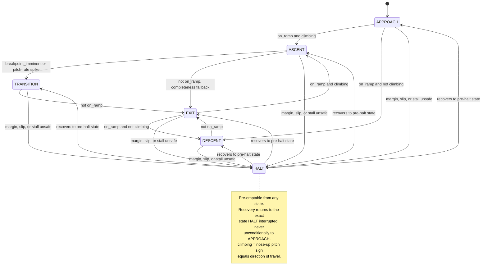
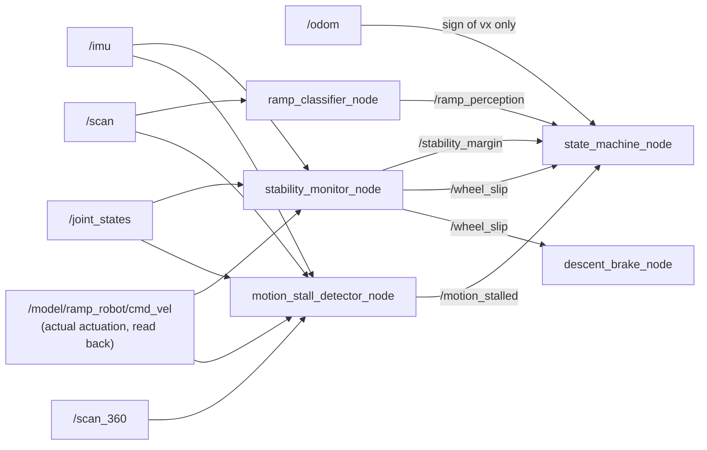
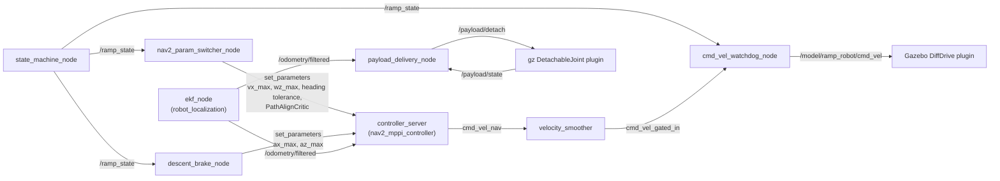
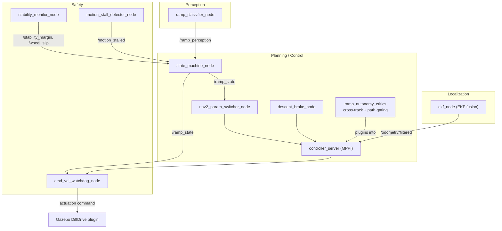

# Architecture

## Packages

```
ramp_autonomy_ws/
├── ramp_autonomy_description/   robot xacro (MiR100 chassis visuals, cosmetic-only), payload link, cargo_mode demo mode
├── ramp_autonomy_gazebo/        world files (construction_site.sdf, ramp_world_sharp/curved.sdf), spawn launch
├── ramp_autonomy_nav/           5-state FSM, Nav2 MPPI parameter switching, cmd_vel watchdog, path construction
├── ramp_autonomy_perception/    LiDAR-based ramp slope + break-point classifier
├── ramp_autonomy_msgs/          RampPercept.msg
├── ramp_autonomy_control/       stability margin monitor, wheel slip, motion stall detector, descent braking, payload delivery
├── ramp_autonomy_critics/       two custom nav2_mppi_controller critic plugins (cross-track, path-gating probe)
├── ramp_autonomy_bringup/       single launch file tying the whole stack together
└── validation/phase8/           the test harness, diagnostic scripts, and every session's logged data
```

`ramp_autonomy_*` are ROS2 packages under `src/`. `validation/` is a plain directory, not a package - it holds test scripts and logs that
depend on the packages above, not code they depend on.

## The ramp state machine



`state_machine_node.py` owns this and publishes it on `/ramp_state`. A slope's direction (ASCENT vs. DESCENT) is decided locally - nose up and
moving forward is ASCENT, otherwise DESCENT - not by position in a fixed cycle, which is what let a two-ramp site mislabel the second ramp's
climb as DESCENT until that was found and fixed (see `retrospective.md`). `ASCENT` always reaches `EXIT` even if neither of its usual triggers
fires, through a completeness edge (`ASCENT and not on_ramp -> EXIT`) added as defense in depth. HALT recovery returns to whatever state it
actually interrupted, not unconditionally to `APPROACH` - the five `HALT -> *` edges above are one mechanism (`self._pre_halt_state`), not five
separate rules.

HALT itself is pre-emptable from any state and fires from three independent triggers, checked on the callback that carries each signal rather
than on a slow-poll timer: tip-over margin below threshold, wheel slip above threshold, or a confirmed motion stall. Any one is sufficient.

The three do not run at the same rate, and the difference is larger than it looks. Measured live: `/imu` publishes at 95.6 Hz and both LiDARs at
about 9 Hz, matching what the xacro declares, but `/joint_states` is published by `gz-sim-joint-state-publisher-system` with no rate limit, so it
arrives every 1 ms physics step at about 936 Hz. `stability_monitor_node.py` recomputes slip on each of those and republishes `/wheel_slip` at
about 987 Hz. So the margin path runs at IMU rate and the slip path runs roughly fifty times faster, which is where most of this project's CPU
goes - see `known-limitations.md` for the measurements and for why the obvious rate limit does not work.

## Node and topic graph

Split into two diagrams - the sensing/safety side and the command/actuation side - rather than one dense graph. Both are drawn from the actual
`create_subscription`/`create_publisher` calls in each node, not a simplified version.

**Sensing and safety signals**, all feeding into the state machine's HALT decision:



**Command and actuation path**, from `/ramp_state` down to the robot, plus the delivery event:



## Layers and how they connect



Perception feeds planning a look-ahead trigger; planning/control drives the robot through the one actuation path every speed-affecting node
shares; safety sits across all of it as an independent veto (margin, slip, and stall can each force HALT regardless of what planning/control is
doing); localization is what planning/control actually trusts for position, separately from whatever perception or safety are reporting.

**Perception.** `ramp_classifier_node.py` reads `/scan` (a 2D LiDAR rolled 90° to produce a fore-aft ground-profile fan rather than a level ring)
and fits a piecewise two-segment or multi-segment model to find the ramp's break point and slope, publishing `RampPercept` on `/ramp_perception`.
This feeds a pre-emptive `ASCENT -> TRANSITION` trigger in the state machine, ahead of the IMU-rate fallback.

**Control.** `stability_monitor_node.py` computes a pitch-axis tip-over margin from IMU orientation and per-wheel commanded-vs-actual rotation
rate from `/joint_states` against the commanded `cmd_vel`, publishing `/stability_margin` and `/wheel_slip`. `motion_stall_detector_node.py` adds
a third signal neither of those can see: a chassis that's genuinely stuck while its wheels keep turning near their commanded rate. It uses LiDAR
scan-consistency (preferring the 360° sensor, falling back to the ramp-profiling one when the platform is too open for the 360° sensor's range)
as the primary signal, with a short-window IMU forward-acceleration check as a non-authoritative early warning. It also publishes
`/verified_progress_m`, a wheel-rotation distance signal gated on the scan-consistency check never having latched - an EKF-free way to tell
whether a leg's displacement is real. `descent_brake_node.py` closes a loop on `/wheel_slip` during DESCENT, capping MPPI's `ax_max`/`az_max`
rather than its `vx_max` (see `retrospective.md` for why that distinction matters).

**Navigation.** `nav2_param_switcher_node.py` subscribes to `/ramp_state` and pushes a matching MPPI parameter profile
(`flat_mode`/`ramp_mode`/`transition_mode`/`descent_mode`/`halt_mode`) into `controller_server` on every state change, reading the parameters back
afterward to confirm the push actually landed rather than assuming success. `ramp_autonomy_critics` adds two plugins to
`nav2_mppi_controller`: an explicit cross-track critic and a path-gating probe, used in the structural experiment that root-caused the curved
world's edge-departure failures (see `retrospective.md`).

**Localization.** Wheel odometry (`/odom`) and the IMU are fused by `robot_localization`'s `ekf_node` into `/odometry/filtered`, which
`controller_server` reads and which owns the `odom -> base_footprint` transform. The EKF fuses wheel odometry's velocity, not its absolute
position - fusing position re-imports the same yaw-under-slip corruption fusing orientation was meant to fix.

**Safety enforcement.** `cmd_vel_watchdog_node.py` sits inline, the sole publisher of the robot's real actuation topic:

```
controller_server -> cmd_vel_nav -> velocity_smoother -> cmd_vel_gated_in -> cmd_vel_watchdog_node -> /model/ramp_robot/cmd_vel
```

While `/ramp_state != HALT` it passes the command through unchanged; while `== HALT` it ramps the command to zero at the platform's own rated
deceleration, independent of whether the MPPI parameter push for `halt_mode` ever landed. This is a single mandatory gate, not a second
publisher racing the controller for the same topic - every node in this project that could plausibly command velocity directly (the descent
brake, the param switcher) adjusts a controller parameter instead of publishing a competing Twist.

**Delivery.** `payload_delivery_node.py` watches the robot's own EKF pose and fires `/payload/detach` once the robot is stopped in the delivery
zone with the payload still attached, zeroing the stability monitor's payload mass once Gazebo confirms the release. The payload itself is
either a fixed joint on the chassis (`cargo_mode:=secured`, the default and the only mode any validated test uses) or a separate free rigid body
released by a `gz-sim-detachable-joint-system` plugin.

## Key topics

| Topic | Published by | Consumed by |
|---|---|---|
| `/ramp_state` | `state_machine_node` | `nav2_param_switcher_node`, `cmd_vel_watchdog_node` |
| `/ramp_perception` | `ramp_classifier_node` | `state_machine_node` |
| `/stability_margin` | `stability_monitor_node` | `state_machine_node` |
| `/wheel_slip` | `stability_monitor_node` | `state_machine_node`, `descent_brake_node` |
| `/motion_stalled`, `/verified_progress_m` | `motion_stall_detector_node` | `state_machine_node`, test harnesses |
| `/odometry/filtered` | `ekf_node` | `controller_server` |
| `/imu`, `/scan`, `/scan_360`, `/joint_states` | Gazebo sensor plugins | `stability_monitor_node`, `ramp_classifier_node`, `motion_stall_detector_node` |
| `cmd_vel_nav` -> `cmd_vel_gated_in` -> `/model/ramp_robot/cmd_vel` | `controller_server` / `velocity_smoother` / `cmd_vel_watchdog_node` | the Gazebo DiffDrive plugin |
| `/payload/detach`, `/payload/state` | `payload_delivery_node` / the DetachableJoint plugin | each other |

## What this project does not have

No `planner_server`, `bt_navigator`, AMCL, or map - there is no waypoint-following goal source. Every test in this project drives the robot with
either a manual `/cmd_vel` publish or a hand-built `FollowPath` goal. See `roadmap.md`.
