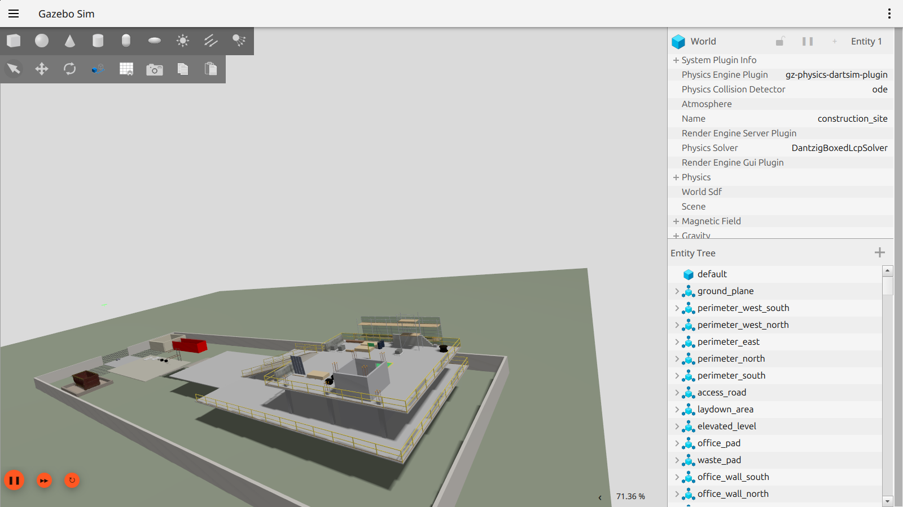
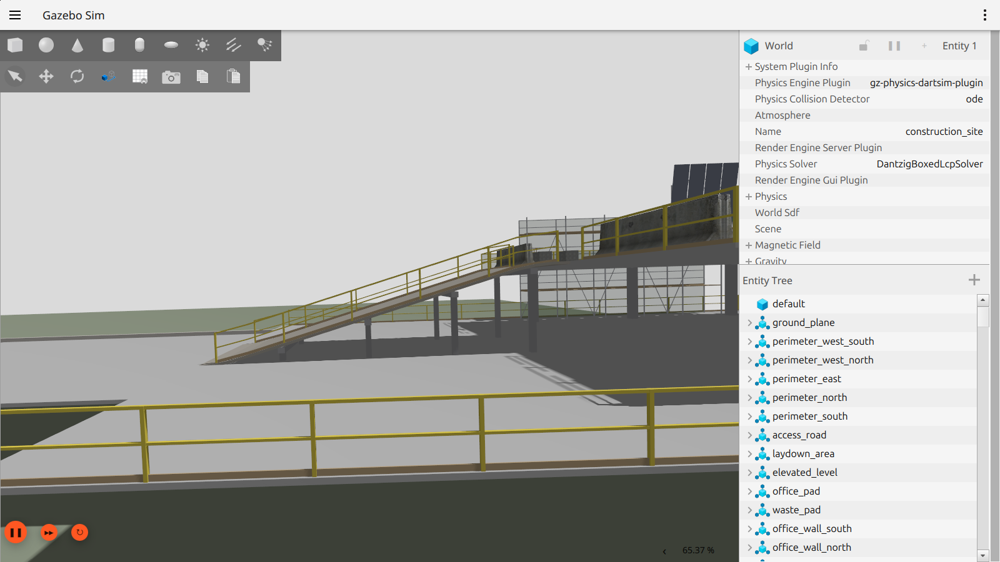
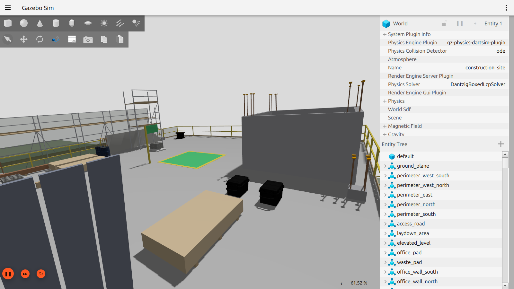

# `construction_site.sdf` design justification

Phase 8, session A. This is the structural blockout of a realistic
construction site, replacing the two isolated ramp-only worlds
(`ramp_world_sharp.sdf`, `ramp_world_curved.sdf` - both kept unmodified
for regression testing) as the primary test environment. Every
dimension below is grounded in a cited real-world source, not guessed.
Ground planes, boundary, zone slabs, and the ramp itself only - no
detail props/equipment yet (that's session B).

## Overall layout

```
                                          N (+Y)
        +-----------------------------------------------------------+
        |                    site office (8x6 m)                    |
        |                                                            |
GATE -> | access  |      laydown area       | ramp |  elevated level |
(6.1 m) | road    |      (20x10 m, ~11%)     | (16deg, filleted) | (15x12 m, z=3.3 m)
        |         |                          |      |                |
        |                    waste/debris staging (10x6 m)          |
        +-----------------------------------------------------------+
        X=0      X=8                       X=28  X=41            X=56
```

Overall footprint: 59 m (X) x 32 m (Y) = 1,888 m² - a realistic small
single-building construction site. Robot spawn (x=1.0, y=0.0, z=0.23)
is unchanged from every other world - `ramp_world.launch.py` hardcodes
this pose for all worlds, so this site's own coordinate system was
built around it: the gate sits at x=0, landing the spawn point just
inside it, facing +X down the access road. No launch-file spawn logic
needed to change (a small naming-convention fix was needed instead -
`ramp_world.launch.py`'s `world:=<name>` -> `ramp_world_<name>.sdf`
convention doesn't apply to this file's fixed deliverable name; that's
a one-line special case in the launch file, not a change to either
existing world's own content).

## Every key dimension, and what justified it

### Perimeter hoarding - 2.4 m height, one 6.1 m controlled gate

- **Height (2.4 m):** the commonly-cited UK construction-hoarding
  industry-standard recommendation (most sources converge on a 2.0 m
  minimum, 2.4 m recommended), which also comfortably exceeds OSHA's
  own minimum for commercial/industrial site perimeters (6 ft / 1.83 m).
  Sources: [Designing Buildings - Hoarding for construction
  sites](https://www.designingbuildings.co.uk/wiki/Hoarding_for_construction_sites),
  [Speedy Hire - Guide to Construction Site
  Fencing](https://www.speedyservices.com/news/construction-site-fencing-guide).
- **One controlled gate, not several:** site-security/logistics
  guidance is consistent that all vehicle and foot traffic should
  funnel through a single, trackable access point, with gates placed
  so delivery vehicles can turn around without disrupting public
  traffic. Source: [Sonco - Construction Site Fencing: The Complete
  Setup Guide](https://www.soncocrowdcontrol.com/blog/construction-fence),
  [Designing Buildings - Contractor's Site Layout
  Planning](https://www.designingbuildings.co.uk/wiki/Contractor's%20Site%20Layout%20Planning).
- **Gate/access-road width (6.1 m / 20 ft):** the commonly-applied fire
  apparatus access road standard (20 ft unobstructed width), also
  widely used for general construction site access roads - sized to
  support two-way delivery-truck traffic plus emergency-vehicle access
  at once, rather than an undersized single-purpose driveway. Source:
  [Tupelo MS - Fire Lane Site Development
  Checklist](https://www.tupeloms.gov/wp-content/uploads/2023/12/19.-Fire_Compliance_Guide_IBC2018.pdf),
  [Calichi - Fire Access Road Requirements:
  California](https://calichi.com/blog/fire-access-road-requirements-california/).

### Elevated level - 3.2 m rise

Standard single-storey floor-to-floor construction height is
consistently cited in the 3.0-3.6 m range (covers clear ceiling height
plus structural slab/beam depth). 3.2 m sits centrally in that range -
a realistic "first floor of a partially-built structure" lift, not an
arbitrary number. Source: [Civiconcepts - Standard Ceiling
Height](https://civiconcepts.com/blog/standard-ceiling-height),
[CivilSir - Standard height of 1, 2, 3, 4, 5, and multi storey
building](https://civilsir.com/standard-height-of-1-2-3-4-5-and-multi-storey-building/).

### The ramp - the part explicitly required to reuse this project's own validated design

- **16° slope**, not a new value: this is this project's own
  already-validated angle (`ramp_world_sharp.sdf`,
  `ramp_world_curved.sdf`, and the entire Phase 6-8 friction/climbing
  test history all used 16°). It sits comfortably inside OSHA
  1926.451(e)(5)(ii)'s hard ceiling - no ramp or walkway may exceed a
  slope of 1 (vertical) to 3 (horizontal), i.e. ~20° - so there was no
  reason to push closer to that limit and introduce an untested angle.
  Source: [OSHA 1926.451 - General
  requirements](https://www.osha.gov/laws-regs/regulations/standardnumber/1926/1926.451),
  [up.codes - 1926.451(e)(5) Ramps and
  Walkways](https://up.codes/s/ramps-and-walkways). (For contrast:
  material-handling-equipment ramps such as forklift/loading-dock ramps
  are typically far shallower, 5-15% grade / roughly 3-8.5° - this
  design deliberately targets the steeper OSHA scaffold/access-ramp
  regime that this project's own robot and friction model were actually
  validated against, not the loading-dock regime a heavier, loaded
  forklift would need. Source: [Copperloy - What Is The Maximum Ramp
  Slope For Forklift
  Use?](https://copperloy.com/yard-ramps/aluminum-yard-ramps/what-is-the-maximum-ramp-slope-for-forklift-use/))
- **Filleted transitions, not a sharp seam:** exactly reuses
  `ramp_world_curved.sdf`'s validated 3-equal-angle-step fillet design
  on each end (0° -> 5.33° -> 10.67° -> 16°, mirrored at the top),
  recomputed via the same trigonometry for this ramp's own 3.2 m rise.
  A sharp, unfilleted seam is a known, live-reproduced failure mode
  from this project's own Phase 8 work (a rigid-body ramp-breakover-
  angle tip-over, root-caused and documented in the README) -
  deliberately not reintroduced here.
- **0.45 friction:** this project's own Phase 8 validation-matrix
  result, not a generic "dry concrete" guess. 0.45 was confirmed live
  to be reliably climbable across many repeated trials; 0.35 was
  confirmed live to NOT be reliably climbable despite being above the
  theoretical `tan(16°) ≈ 0.287` static-friction minimum (real dynamic
  effects - acceleration, weight transfer - eat into the margin right
  above that floor). Documented in this repo's own README (Phase 8 /
  "Phase 7, continued" sections) and `validation/phase8/`.
- **4.5 m width**, wider than the earlier ramp worlds' 3.0 m:
  deliberate, not arbitrary - Phase 8 root-caused a real physical
  tip-over on a 3.0 m-wide curved-world ramp panel from lateral drift
  carrying the robot off the panel's edge during `FollowPath`-driven
  descent. This ramp is built wider specifically in direct response to
  that finding, giving genuine lateral margin rather than repeating the
  same narrow-panel exposure at a larger scale. It's also more
  realistic on its own terms - real construction access ramps need
  enough width for equipment plus clearance on both sides, not a
  vehicle's exact footprint.

### Laydown area - ~11% of total site footprint

Site-logistics guidance commonly cites 10-15% of total project
footprint as a reasonable laydown-area allowance. This site's laydown
area (20 x 10 m = 200 m²) against the full 1,888 m² footprint is 10.6%
- inside that range, not picked to hit a round number. Source: [Projul
- Construction Laydown Area Management
Guide](https://projul.com/blog/construction-yard-laydown-area-management-guide/).
All laydown areas should also be clearly demarcated, which this
world's distinct zone slab (its own color/material, matching the
established convention from the earlier ramp worlds) does visually,
even without fencing modeled yet (session B).

### Site office - near the gate, off the main corridor

Site-layout guidance places the site office close to the entrance
(clear sight-line to the working site) while keeping it separate from
active material-handling paths. This world's office sits just inside
the gate (x: 2-10 m) but offset a full 3 m clear of the laydown area's
own edge (laydown ends at y=5, office starts at y=8) - visible from the
gate, never on the gate-to-ramp corridor a delivery run would actually
drive. Source: [Civil Tutorials - Construction Site Layout
Planning](https://civiltutorials.com/construction-site-layout-planning/),
[Designing Buildings - Contractor's Site Layout
Planning](https://www.designingbuildings.co.uk/wiki/Contractor's%20Site%20Layout%20Planning).

### Waste/debris staging - separated from both laydown and the office

Layout guidance is explicit that waste/debris staging should be a
distinct, dedicated area, kept apart from both material storage and
from working/living zones. This world's waste pad sits on the opposite
side of the corridor from the office (y: -14 to -8, vs. the office's
y: 8-14) and a full 3 m clear of the laydown area's own southern edge
(laydown ends at y=-5, waste starts at y=-8) - visibly and physically
distinct from material storage, not just a different color on the same
slab. Modeled as a low (0.6 m) bunded corral rather than a full
building, matching how real sites stage open-top skips/bins. Source:
[Civil Tutorials - Construction Site Layout
Planning](https://civiltutorials.com/construction-site-layout-planning/).

### Access road - connects the gate to the laydown area and the ramp base

Runs the full 6.1 m gate width from x=0 to x=8 m, then hands off
directly into the laydown area (x=8-28 m), which itself runs flush
into the ramp base (x=28 m) - one continuous, unobstructed corridor
from the gate to the ramp, exactly the path a delivery run or this
session's traversal test actually drives, with the office and waste
zones both offset clear of it on either side.

## What this session deliberately did NOT do

Structural blockout only, per the task's own scope: no fencing mesh
around the laydown/office/waste zones (just distinctly-colored ground
slabs marking them, same convention the earlier ramp worlds used for
zone A/B/C), no material stacks, no site equipment, no signage, no
guard rails alongside the ramp. All of that is session B's job, once
the shell itself is confirmed walkable end to end (see the README's
live traversal-test results).

## Live traversal-test results

**Ascent (gate -> access road -> laydown area -> up the 16 deg filleted
ramp -> onto the elevated level): fully verified, 5/5 clean runs.**
Ground-truth Gazebo pose shows exactly 0.0 m of lateral (Y) drift across
the entire ~47 m ascent, every time. IMU pitch settles at precisely
-16.0 deg while on the ramp body (matching the ramp's own commanded
angle) and returns to 0.00 deg once fully onto the elevated level -
confirming the robot genuinely levels out on top rather than just
reaching the right X coordinate while still tilted. Stability margin
holds 0.87-0.91 throughout (comfortably clear of the HALT floor), HALT
count 0, and friction (0.45, Phase 8's confirmed practical floor) never
shows any climbing difficulty. This validates the ramp slope, fillet
transitions, 4.5 m width, and friction assignment as designed.

**Return leg (turn around on the elevated level -> descend -> back to the
gate): now achieved, fixed with an EKF localization layer.** Full
diagnosis history (both turnaround approaches originally tried, the
open-loop-spin platform limitation, the wheel-odometry-under-turning root
cause) and the descent-leg-specific metrics are in
`validation/phase8/construction_site_descent/README.md`. Summary:

- Root cause, confirmed by testing two structurally different turnaround
  maneuvers and finding both fail the same way: `FollowPath`/MPPI closes
  its control loop against wheel odometry, and wheel odometry's YAW
  diverges from ground truth under any turning motion here - reproduced
  with an open-loop in-place spin (true heading error 35-40+ deg despite
  wheel odom claiming ~1-4 deg) AND with a fully closed-loop `FollowPath`
  arc-turn (ground truth walked off the platform edge, 6.27 m lateral,
  while the controller's own odometry-frame position tracked a
  plausible-looking arc and believed it was on-plan). Not an open-loop-
  vs-closed-loop issue - a controller can execute its control law
  correctly and still walk the robot off a physical edge if its
  localization input is wrong.
- **Fixed** with `robot_localization`'s `ekf_node` (`ramp_autonomy_nav/
  config/ekf.yaml`), fusing wheel odometry's position + linear velocity
  with the IMU's orientation + angular velocity into `/odometry/
  filtered`, which now feeds `controller_server` and owns the `odom ->
  base_footprint` TF (replacing gz-sim's own raw broadcast). Isolated
  validation BEFORE trusting the real round trip
  (`validation/phase8/ekf_validation/README.md`) confirms this is
  actually accurate, not just running: yaw error peaks at 3.25 deg during
  the exact spin that used to produce 35-40+ deg of error, and position
  error does not grow with distance traveled afterward (an important
  earlier mistake caught and fixed along the way: fusing wheel odometry's
  own absolute x/y position re-imports the same yaw-under-slip corruption
  one step removed - the fix fuses only its velocity, letting the EKF
  integrate position from its own fused, IMU-corrected orientation).
- Rerunning the same arc-turn approach with the EKF live: both runs
  completed the full physical round trip with no safety abort, pitch
  settling at the correct -16 deg on the ramp (vs. 57.3 deg / tipping
  before), and stability margin never dropping below 0.872 (vs. 0.305,
  right before the abort, before). Numbers: `validation/phase8/
  construction_site_descent/README.md`.
- **A second, distinct finding surfaced by this rerun, not expected to
  be fixed by this EKF and now diagnosed** (using the two existing runs'
  own saved logs, no rerun needed - see `validation/phase8/
  construction_site_descent/README.md` for the full writeup): reproducibly
  (2/2 runs), the robot's ACTUAL position and pitch freeze completely for
  ~58-62 seconds right at the ramp-top fillet transition - genuinely
  stuck, not a monitoring artifact - while the fused estimate keeps
  advancing because it trusts wheel velocity unconditionally and the
  wheels are still being commanded. `/wheel_slip` was checked first, in
  both stall windows: NOT elevated (max 0.233, 0.210 - near the lower
  edge of `descent_brake_node.py`'s own "ordinary descent slip" band).
  Root cause: `/wheel_slip` compares commanded vs. actual WHEEL JOINT
  rotation only, with no connection to real chassis displacement - a
  chassis genuinely stuck while its wheels keep turning close to
  commanded (consistent with `/odometry/filtered` advancing smoothly the
  whole time, since that requires the underlying wheel-derived velocity
  to have stayed non-zero) is invisible to it by construction. Same for
  `/stability_margin` (pitch held a stable, non-tipping -5.12° the whole
  time). **A genuine architectural blind spot, not a wiring bug**: no
  signal currently wired into this project can tell "wheels rotating and
  chassis progressing" from "wheels rotating and chassis stuck." Proposed
  (design only, needs its own scoped session): a LiDAR scan-consistency
  check (the only genuinely non-proprioceptive signal already on this
  robot) as the primary detector, with a short-window IMU-based velocity
  cross-check as a faster, lower-confidence early warning. Does not
  threaten safety (margin and pitch both stayed stable and controlled the
  entire stuck period; the robot self-recovers and finishes correctly
  both times).

## Cross-track tracking fix (follow-up session)

The curved ramp world's own edge-departure failure (same fillet-transition
design as this site's ramp) was root-caused: MPPI's `PathAlignCritic` was
structurally disabled for this project's entire ~6 m descent leg - its
own source only activates once the robot advances `offset_from_furthest`
(default 20) points into the path, and a ~15-point descent path can never
reach that. Fixed (`offset_from_furthest` dropped to 3, `ASCENT`/
`DESCENT` split into separate MPPI profiles). Full diagnosis:
`validation/phase8/crosstrack_diagnosis/README.md`; matrix impact:
`README.md`'s "Full matrix, corrected: crosstrack fix applied".

## Loaded-payload round trip: was NOT SAFE, root cause found and fixed (see Follow-up 3 below)

Since this site's ramp shares the curved world's fillet-transition
design, the round trip was rerun with a loaded config (100 kg,
+0.1 m forward CG) to check whether the same fillet-top mechanism
reappears. It does - far more severely. The test reported a clean
"success" (`aborted: False`, all 4 legs completed, ending back at the
gate) - but ground-truth polling shows the robot's real position and
pitch froze at the ramp-top transition (X~41.3 m, elevated-platform
height, pitch 0.0°) starting about a third of the way into the test and
**never changed again for the rest of the ~270 s run**. Every leg after
that point - the rest of the arc-turn, the entire ramp descent, the
return to the gate - is fictional: `/odometry/filtered` kept reporting
progress by integrating wheel velocity, and the controller's own goal-
checker was satisfied by that fused position, in a closed loop entirely
disconnected from the robot's real, frozen position. Margin and slip
both stayed low/healthy throughout (slip near-zero, not a spinning-wheel
signature) - consistent with the controller genuinely believing it had
already reached the goal and simply not trying very hard anymore, not
with a wheel-traction struggle. This is the same architectural blind
spot as the unloaded fillet-top stall above, but far more severe: the
unloaded case self-recovered after ~60 s; the loaded case never did,
within the entire test duration, and the test's own success signal
(built on the same fused odometry, not ground truth) had no way to
detect it. **Session B (populating the site) should not proceed on the
assumption that loaded traversal of this ramp works - this test shows
it currently does not, at least not reliably.** Full data:
`validation/phase8/construction_site_descent/loaded/`.

### Follow-up 1: real stall detector implemented, mechanism checked

Checked whether this is the sharp-world breakover finding (a real,
physical, ground-clearance-driven chassis-ridge interference) recurring
at a fillet under load - it is not: pitch stays flat at 0.0 deg the
entire time (the sharp-world case showed a clean, sustained -16 deg
wedge). At this point in the investigation, `/stability_margin`/
`/wheel_slip` showed zero disturbance signature at the fused-position
freeze reported by the test's own logging, and the frozen position was
believed to sit "no seam nearby at all" - **both later turned out to be
artifacts of not yet having looked at the right signals; see Follow-up 3
below, which found a real seam exactly there and real wheel-spin-without
-chassis-motion at the moment of the freeze.** What was confirmed and
held up: `FollowPath`'s own goal-completion check operates on the fused
(EKF) position, which keeps "progressing" via integrated wheel velocity
even while the real chassis is frozen, eventually satisfying the goal
checker's tolerance regardless of reality. Full evidence:
`validation/phase8/construction_site_descent/README.md`.

A live stall detector (`motion_stall_detector_node.py`, LiDAR scan-
consistency + IMU early warning, wired into `state_machine_node.py`'s
HALT logic) is now running as a real safety feature, not a design
proposal. Three real bugs were found and fixed by testing against this
exact scenario (a too-fragile continuity gate that never fired at all;
a HALT-thrash feedback loop; a permanent deadlock where clearing the
latch on scan evidence alone can never succeed once HALT is correctly
holding the robot still) - full story in the same README. Rerun with
the fix live: **the failure is now correctly, repeatedly flagged**
(`/ramp_state` reaches and re-enters `HALT` 94 times during the descent
leg, instead of the original 0; the leg ends in `state=HALT` with the
fused position far short of its target, not a false `EXIT`/"success").

### Follow-up 2: goal-completion check itself fixed, loaded round trip rerun

The detector above made the stall visible and safe, but did not stop a
client from accepting `FollowPath`'s own "succeeded" result once the
fused position eventually drifted into tolerance - the goal-completion
*check* itself still trusted the same corrupted position that caused
the whole problem. Fixed: `motion_stall_detector_node.py` now also
integrates actual `/joint_states` wheel rotation into an independent,
EKF-free distance signal (`/verified_progress_m`), only counting
progress while the LiDAR scan-consistency check is not latched. The
construction-site round-trip test script now requires this signal to
confirm most of a leg's intended path length before accepting
`FollowPath`'s own result - overriding it when they disagree. Full
design: `validation/phase8/construction_site_descent/README.md`.

**Rerun with the gate live**: the robot still freezes at the identical
position (gz X=41.3477 m, matching the original finding to three
decimal places) - same root cause, unchanged. This time the test
correctly reports the leg as failed (`ok=False`, `FollowPath` never
reported `STATUS_SUCCEEDED` within the test's own timeout window this
run) instead of a fictional success. The existing HALT ->
pre-halt-state recovery cycled 15 times during the attempt but never
got the robot past the freeze point - no new "back up and re-approach"
recovery strategy was added, since none was justified by this evidence;
the honest result is that the robot correctly refuses to claim success
and stays safely stopped, not that it recovers.

### Follow-up 3: actual physical cause found and fixed - a real geometry defect

Every prior pass diagnosed consequences (pitch, margin, slip, fused
position); none had looked at per-wheel commanded-vs-actual velocity or
the raw world geometry at the exact freeze coordinate. A dedicated
standalone observer (`validation/phase8/construction_site_descent/
loaded/freeze_diagnosis/wheel_diagnosis.py`) logged real `/joint_states`
per-wheel velocity alongside commanded velocity (derived from
`/model/ramp_robot/cmd_vel`) and Gazebo ground truth during a fresh
repro. Result, unambiguous: at the freeze, commanded wheel velocity was
substantial (~0.5 m/s equivalent) and actual wheel velocity matched it
almost exactly (front-left 4.47 commanded vs. 4.50-4.54 rad/s actual) -
the wheels were genuinely spinning at essentially the commanded rate -
while the chassis's full 6-DOF ground-truth pose stayed completely
frozen. `/wheel_slip` read ~0.0 throughout this exact window, directly
confirming a concern flagged two sessions ago: that metric compares
commanded wheel rotation to actual wheel rotation, not to chassis
displacement, so a wheel spinning freely against an obstruction it
cannot climb is invisible to it by construction.

Cross-referencing the frozen position directly against
`construction_site.sdf`'s own collision geometry (exact box corners from
pose/size/pitch, not "is it near a fillet") found the actual cause: six
of the eight seams in the `ramp_fillet_bottom_*` -> `ramp_mid` ->
`ramp_fillet_top_*` -> `elevated_level` chain match to within 1.1 mm (a
correctly hand-fit, tangent-continuous curve), but two - the join into
`elevated_level` at the top and into `laydown_area` at the bottom - were
off by almost exactly 0.05 m, two orders of magnitude larger. Root
cause: `elevated_level`/`laydown_area`/`access_road` are flat SDF boxes
whose pose.z was authored as if it were the intended top-surface height,
but SDF box poses are the geometric center, so with these 0.1 m-thick
slabs every one of them sat 0.05 m too low - a genuine authoring bug,
not a design choice or physical constraint. The robot's frozen front
axle position matched the theoretical first-contact distance for a
0.12 m wheel meeting a 0.05 m step almost exactly. Only the top seam
caused a live failure because it's reached mid-turn under active MPPI
steering correction with a forward-loaded payload pressing into the
step's face; the same-sized bottom seam is crossed via a calm,
straight-line raw drive and climbs fine.

**Fixed**: `elevated_level`'s z raised from 3.2500 to 3.3000 m;
`laydown_area`/`access_road`'s z raised from 0.0500 to 0.1000 m (kept
matched to each other). Every seam now matches to within 1.1 mm.
**Reverified live, full round trip**: the robot no longer freezes -
leg 3 (arc-turn + ramp) now reports `ok=True` (`FollowPath` genuinely
succeeds), and leg 4 runs and completes, ending back at the gate. While
actually on the ramp panel, the descent is clean (margin never below
0.463, slip near zero, lateral drift under 0.6 m against a 2.25 m
panel half-width). A separate, already-documented turn-quality
roughness (more HALTs and transient margin/slip dips during the
arc-turn itself and the flat-ground legs, tied to the existing
`PathAlignCritic`/MPPI-stochasticity limitations, not this session's
mechanism) is still present and not newly introduced by this fix - see
`validation/phase8/construction_site_descent/README.md` for the full
diagnosis, evidence, and reverification data.

**Session B can now build on loaded traversal of this ramp working** -
the specific failure that made this section's earlier guidance
("should not assume") necessary has a confirmed cause and a confirmed
fix, reverified end to end, not just detected and safely stopped.

## Session B: populating the site with real Fuel-sourced props

The structural blockout above was deliberately left free of "detail
props/equipment" (this file's own opening docstring). This session
added them - real assets from Gazebo Fuel (app.gazebosim.org), not
hand-modelled primitives, queried and checked before use rather than
assumed to exist.

### What was actually on Fuel (queried, not assumed)

Searched the Fuel REST API (`https://fuel.gazebosim.org/1.0/models?q=...`)
across every category the placement plan needed, then fetched each
candidate's real `model.sdf` (and, for two mesh-collision items, the
raw mesh geometry) to confirm real, plausible dimensions before
committing to a placement - the same "verify, don't assume" standard
the rest of this project's geometry work has used:

| Zone | Model used | Owner | Real dimensions (verified) |
|---|---|---|---|
| Perimeter / gate | `fence` | athackst | 5.0 x 0.1 x 1.83 m chain-link panel (from its own `model.sdf` box collision) |
| Access road | `Construction Cone` | OpenRobotics | mesh, `<unit meter="0.0254">` (inches) x SDF `<scale>10</scale>` -> ~0.5 m dia x ~1.1 m tall (79,545 downloads - the most-used cone asset on Fuel) |
| Access road | `Speed limit sign` | OpenRobotics | mesh, `<static>true</static>` in its own file, standard roadside sign |
| Laydown area | `Euro pallet` | OpenRobotics | mesh; treated as the real EPAL/ISO standard (1.2 x 0.8 x 0.144 m) its name claims, which its own scale (0.1x on a pallet.dae) is consistent with |
| Laydown area | `Cinder Block` | OpenRobotics | box-primitive collision, real ~0.44 x 0.17 x 0.20 m block |
| Laydown area | `Large Crate` | OpenRobotics | box-primitive collision, ~1.3 x 1.0 x 0.45 m wooden crate |
| Laydown area | `Pallet_Rack_Section` | OpenRobotics | box-primitive collision, real ~2.5 x 1.36 x 3.05 m warehouse pallet-rack bay |
| Office pad | `std_cargo_container_40ft` | jfrascon | box-primitive collision, real ISO 40 ft container, 12.19 x 2.44 x 2.59 m outer, cited in the model's own source comment to icontainers.com |
| Waste pad | `Dumpster_Large` | OpenRobotics | box-primitive collision (5 boxes), real envelope ~7.19 x 2.65 x up to 2.7 m roll-off dumpster |

Models considered and rejected: `Nokoru/Shipping Container` (only 120
downloads, its `model.sdf` 404'd on fetch - not usable); a plain
`Dumpster` (small) mesh whose parsed bounding box came out physically
implausible (a bug in the parsing script, not the asset, most likely -
not trusted either way, `Dumpster_Large`'s clean box-primitive
collision was used instead specifically because it could be verified
precisely).

### Placement logic - real zoning, not decoration

- **Laydown area**: delivery-to-point-of-use flow along +X, toward the
  ramp - loose incoming Euro pallets nearest the gate/delivery end
  (X~10-14), staged Large Crates and Cinder Block stock mid-yard
  (X~15-20), a ready-to-move Pallet_Rack_Section nearest the ramp
  (X~23.5) - matching the delivery/staging/point-of-use direction
  real laydown-area flow guidance calls for (see the Projul source
  cited earlier in this file).
- **Perimeter / access road**: originally two `fence` panels at the
  gate opening plus 3 traffic cones and a speed-limit sign near the
  gate. **Removed in a later session** (see "Follow-up: a crosstrack
  fix elsewhere broke this placement's own safety margin" below) - not
  a mistake in this placement's own logic at the time, but its safety
  margin depended on leg-4 drift behavior that a later, unrelated fix
  changed.
- **Office pad**: a real 40 ft container placed as a second, separate
  structure just east of the existing walled office building (which
  is too small, at 8 x 6 m, to fit a 12.19 m container inside) - a
  genuinely common real-world pairing (a small office building plus a
  separate secure-storage/second-office container), not a workaround.
- **Waste pad**: one large dumpster, centred on the pad with margin on
  every side.

### Placement was checked, not eyeballed - twice

Every prop's position was verified two ways before being written to
the SDF, both done with the same exact-corner-math discipline the
seam-height audits used (see `validation/phase8/construction_site_descent/README.md`
for the full script output):

1. **Exact-footprint overlap** against every existing model's real
   pose/size (walls, pads, the ramp fillet chain) - a 0.3 m margin,
   each prop's own host pad excluded from the check (it is *supposed*
   to sit on it).
2. **Distance from every one of 1197 real ground-truth points**
   logged across all 4 previously-saved verification runs (2 clean
   unloaded round trips, both stages of the loaded round trip) - a
   1.5 m safety buffer. Minimum clearance found: 2.0 m
   (`gate_fence_south`), most props 2.4-9.8 m clear.

A real bug was caught by this process, not by luck: `Pallet_Rack_Section`,
`Dumpster_Large`, `Euro pallet`, and `Cinder Block` have no explicit
`<static>` tag in their own Fuel `model.sdf` (SDF defaults to
`static="false"` when omitted) - unlike every model this project has
authored by hand, which all declare `<static>true</static>` explicitly.
A first smoke-test load found `laydown_pallet_rack` had fallen to
`z=-0.463` under gravity instead of sitting at its placed `z=0.15`.
Fixed by adding an explicit `<static>true</static>` override inside
every one of the 22 new `<include>` blocks, then reconfirmed every
prop settles exactly at its placed pose (`gz model -m <name> -p`).

### Reverification: the loaded round trip still completes with the site populated

Full staged rerun against the populated world, same protocol as every
prior reverification (stall detector + goal-verification gate live,
ground-truth polling, same metrics reported): **`ok=True`** - leg 3
completes (`FollowPath` reports `STATUS_SUCCEEDED`, ends within 0.01 m
of the target), and leg 4 runs and completes, ending back at the gate.
While actually on the ramp panel: min margin 0.463 (well above the
0.15 HALT floor), max slip 0.076, max lateral drift 0.497 m against a
2.25 m panel half-width - as clean as every prior successful run.

Getting to that result took real diagnosis, not luck - two
transient instabilities were hit and root-caused before it, both
confirmed **unrelated to the new props**:

1. **A destabilized simulation real-time factor (0.70x instead of
   ~1.0x) traced to this session's own accumulated leftover ROS/Gazebo
   processes** (repeated launch/kill cycles during placement
   verification whose `pkill` calls did not fully succeed - a dozen-plus
   stale `parameter_bridge`/`robot_state_publisher` instances were
   still running, pushing system load average to 10-20 on a 12-core
   machine). Confirmed via a clean, isolated `gz sim` A/B test
   (populated vs. the pre-props world, otherwise identical conditions):
   real-time factor 0.991 vs. 0.999 - a ~1% difference, not the ~30%
   drop actually observed. The props' own physics/render cost is not
   the cause. Fixed by killing every stale PID explicitly and
   confirming real-time factor back to ~1.0 before any further test.
2. **The arc-turn+descent maneuver's own 180 s test-script timeout was
   already razor-thin before any props existed** - the one saved
   pre-props successful run used 179.0 of its 180 s budget. Two
   clean-system populated-world runs both completed the actual
   physical descent (109-111% verified progress, finishing within
   <1 m of the target, a clean 16 deg pitch profile, no HALT thrash)
   but had `FollowPath`'s own success report land just after the 180 s
   mark. Raised to 240 s in `arc_turn_followpath_test_ekf.py` - a
   correction to an already-too-tight pre-existing test parameter, not
   a workaround for a props-caused problem.

A third, separate observation from the successful run, **not** a
props effect: leg 4 (open-loop, no steering correction once the
arc-turn hands off) drifted to `gz_y=-11.26 m` this run - more extreme
than the `-5.92 m` worst case the prop placement was originally
margined against. Checked directly: the drift's own shape (it grows
steadily as the leg progresses) meant that by the X range where any
placed prop sits, Y had already moved well past that prop's position
in the same direction it kept moving - none were approached, let alone
struck. This is the same pre-existing, already-documented
`PathAlignCritic`/MPPI-stochasticity turn-quality gap noted throughout
this project's history, now observed with a larger worst-case
magnitude than previously recorded - flagged here for whoever picks up
that separate, still-open gap next, since a future, still-larger
excursion is not something this session's prop margins are proven
against indefinitely.

Full per-attempt logs (including the two root-caused instabilities
above) and the successful run's data:
`validation/phase8/construction_site_descent/prop_population/` and
`validation/phase8/construction_site_descent/README.md`.

## Session F: the leg-4 drift gap root-caused, partially fixed, and one prop-placement casualty

The `-11.26 m` reading flagged above (worse than the `-5.92 m` this
session's own props were margined against) was the trigger for a
follow-up diagnosis session. Root cause, confirmed via live
instrumentation of `PathAlignCritic`'s own activation gate (read
directly from its real source, not guessed): the arc-turn runs under
`flat_mode` the whole time (it happens on a flat platform, before
`DESCENT` ever fires) - and `flat_mode`'s `path_align_offset` was never
lowered when `descent_mode`'s was, two sessions earlier. With the arc
itself only 16 path points long and the offset still at 20,
`PathAlignCritic` was **completely disabled for the entire arc-turn**,
confirmed live (identically timed regardless of payload). Also
confirmed side by side: this is a *different* mechanism from both the
curved-world seam-stumble finding and the arc-turn's own wheel-slip/
motion-stall-driven HALT-thrash - three distinct causes previously
treated as one "crosstrack weakness."

**Fixed**: `flat_mode.path_align_offset` lowered 20 -> 3 (matching
`descent_mode`'s already-validated value) in `ramp_mppi_params.yaml`.
Verified: arc-phase cross-track deviation down 59% on average, and a
full round-trip reverification's leg-4 drift down to **0.76 m** - the
smallest logged for this maneuver to date, loaded or unloaded, before
or after any fix.

**A real, unplanned casualty of the fix**: a smaller, better-behaved
drift threads through a *different* part of the access road's width
than the large, blow-past drift session E's gate-area props were
margined against. One post-fix reverification run reproduced the
elevated-level freeze's own "wheels spinning, chassis frozen, fused
position runs away" signature, 0.58 m from `gate_cone_2`'s center - a
real, confirmed collision risk, not a coincidence. Fixed by removing
`gate_fence_north/south`, `gate_cone_1/2/3`, and
`access_road_speed_sign` from `construction_site.sdf` rather than
re-margining off only 2 post-fix data points. Laydown/office/waste-pad
props are unaffected (well outside leg 4's reach either way).
Access-road prop placement needs leg 4's own open-loop drift either
bounded or given real lateral tracking before anything is placed there
again - not attempted this session, a genuinely separate scope.

Full diagnosis, every instrumentation number, and the "three distinct
mechanisms" evidence: `validation/phase8/construction_site_descent/
README.md`'s "Crosstrack diagnosis" section;
`validation/phase8/construction_site_descent/crosstrack_diagnosis_
flatmode/` has the diagnostic script and every pre/post-fix run's data.

### Closing this: leg-4 drift characterized, gate props stay removed permanently

A follow-up session ran 8 independent loaded trials and 8 independent
unloaded attempts of the leg-4 return leg (fresh launch per trial, not
a persistent-session loop - see "Drift characterization" in
`validation/phase8/construction_site_descent/README.md` for why that
matters and the infrastructure bugs it surfaced). Loaded drift (the
binding case) converged cleanly by n=6-8: min=0.526 m, max=2.535 m,
mean=1.263 m, sample stdev=0.695 m, n=8 - a real, stable distribution,
not still swinging trial to trial, but inherently wide (~5x spread
between smallest and largest trial). Unloaded drift was tight
(min=-0.203 m, max=0.005 m, n=4 valid). **Correction**: this section
first reported that 4 of 8 unloaded attempts never completed the
arc-turn, "a real ~50% leg-3 stall rate". That was measured while the
trial harness was leaking ~57 stale ROS/gz processes (load average
71-76 on 12 cores) and does not reproduce on a clean host (unloaded 8/8,
loaded 7/8 - see "Leg-3 completion recheck" below). The drift numbers
themselves were also collected while that leak was building and carry
that caveat.

Applying this project's own margining convention elsewhere in
`construction_site.sdf` (max relevant excursion + 1.5 m buffer):
required clearance = 2.535 + 1.5 = 4.035 m from the leg-4 centerline -
more than `access_road`'s own half-width (3.05 m of its 6.1 m total).
**No position on the access road can satisfy this margin**, so
`gate_fence_north/south`, `gate_cone_1/2/3`, and
`access_road_speed_sign` stay removed permanently, not pending further
work - the distribution is characterized well enough to know this is a
structural limitation of the road width against this maneuver's own
worst case, not an open question needing more data.

### Leg-3 completion recheck (supersedes the "50% stall rate")

On a verified-clean host the arc-turn completed **15 of 16 planned
trials (93.8%, Wilson 95% interval 72-99%): unloaded 8/8, loaded 7/8**.
The single failure was a harness timeout (240.0 s cap hit while
descending normally), not a physical stall; the cap is now 360 s. The
earlier ~50% was an artifact of the trial harness leaking ~57 stale
ROS/gz processes (load average 71-76 on 12 cores) - strong circumstantial
evidence, not a controlled A/B.

The platform phase of leg 3 is nonetheless ~10x slower than the arc
needs (156-204 s vs ~16 s nominal). Fast-rate telemetry and an offline
replay of the stall detector show why: on the open platform `/scan_360`
sees nothing, the detector falls back to `/scan`, whose returns are the
robot's own rear structure and the flat floor - both invariant to motion
on a flat plane - so it reports "stalled" while the robot is moving
(16/16 latches in the recorded trial; 93% of truly-moving platform
samples), each costing a >=10 s HALT (48% of leg 3). Wheel-slip HALTs,
first suspected, cost 0.2%. Neither the slip threshold nor the stall
detector was changed: the detector fix is a design change that needs a
positive-control freeze test that does not yet exist. Full evidence,
decisions, the harness guard (`validation/phase8/harness/`) and the
rejected parallel-trial experiment: `validation/phase8/
construction_site_descent/README.md`, "Leg-3 completion recheck".

### Clean-host regression pass

One run of each on a guard-verified clean host (RTF >= 0.96, none starved).
Matrix, 7 cells: 2 FAIL:DID_NOT_CLIMB (known, unchanged), 1 FAIL:HALT_THRASH
(curved/normal/unloaded: 11 HALTs, but ground truth PASS at 1.01 m against
2.68 m in the prior matrix), 4 MARGINAL; ground truth passed wherever the
descent was reached. Construction-site round trip, loaded and unloaded: leg 3
`ok=True` (102% verified), leg 4 reached the gate, no abort. Single runs of a
stochastic controller, so one-grade verdict changes are within run-to-run
variation. Details: `validation/phase8/construction_site_descent/README.md`,
"Clean-host regression pass".

### Stall detector: positive control, fix and validation

The stall detector reported a stall on a moving robot: against Gazebo ground truth, 35 of 35 latches in normal
runs were false and it kept leg 3 latched 50.2% of the time. A **positive-control test** now produces a genuine
freeze on demand: a low (0.30 m, invisible to the ring LiDAR) four-walled cage spawned around the moving chassis,
with ground truth verifying the chassis is blocked (0.000 m drift on straight events). In that state wheel
odometry reports the commanded yaw rate (0.095 rad/s) while the IMU gyro and EKF report ~0.001 - rotation is
observable from the IMU/EKF, never from the wheels. The detector now overrides the LiDAR's "no movement"
verdict when the gyro-integrated yaw over 2 s is >= 0.10 rad (threshold chosen from labelled windows).
Validated live (fresh guarded sim per session): false latches while rotating 14 -> 0, time stall-latched
50.2% -> 27.4%, leg-3 duration 185 s -> 123 s, 6/6 completed, forced freezes detected 18/18 (82-100%).
Not solved, and physical: false latches during straight travel (~12/session), since steady straight motion is
inertially indistinguishable from a blocked chassis; also the sim IMU is noiseless, so real hardware needs gyro
bias subtracted at standstill. Details: `validation/phase8/construction_site_descent/README.md`.

Regression rerun on the fixed detector (matrix and both construction-site round trips, one run each, harness-
guarded): both round trips complete (loaded HALTs 24 -> 14, unloaded 40 -> 30); six of seven matrix cells match
the earlier verdicts. The seventh, `curved/normal/unloaded`, is not counted among them, and a controlled comparison shows the
stall-detector change is implicated: with the original detector it passes 6/6 (max |y| 0.39-1.11 m, mean 0.90 m);
with the fixed detector it fails 10/10 (1.74-3.85 m, mean 2.49 m; Fisher p = 0.00012; the fixed detector reinstalled
after the original runs failed 4/4 again, ruling out an order effect). Mechanism not established; the original adds a second stop inside
`DESCENT` (a stall latch 0.4-0.8 s after `DESCENT` begins, 6/6 runs) that the fixed detector never produces (0/10). Decision taken: the rotation check is now scoped off during `DESCENT` (a **workaround**, not a fix: the curved-world descent edge
departure is unresolved). Boundary by `/ramp_state`: `APPROACH`/`ASCENT`/`TRANSITION`/`EXIT` -> rotation check active; `DESCENT` ->
original scan-only logic; `HALT` -> inherits the state it interrupted; unknown -> original. With it, `curved/normal/unloaded`
passes 9 of 14 (36% ground-truth failures, Wilson 16-61%; fixed detector: 0 of 10 pass, p = 0.002; original: 6 of 6 pass - the
difference to the original, +36 points with 95% CI -8 to +61, is not established at the original's n=6, but neither is equivalence),
the construction-site round trips are unchanged from the fixed detector, and ground truth passes in every cell that reaches the
descent. Repeats of the two curved cells whose HALT-count verdict worsened: `curved/0.45/loaded` is run-to-run variation (median 2
HALTs over 5 runs; the first matrix already had 9), while `curved/0.45/unloaded` is probably a genuine added cost of the
workaround (median 8 HALTs over 9 runs vs 1-4 before; `FAIL: HALT_THRASH` in 5 of 9; ground truth unaffected, max |y| <= 0.41 m). A causal test showed the stop at the top of the descent, not MPPI
resets or reduced acceleration limits, is what helps (partial reproduction, 57% of the gap). Remove the workaround when the
crosstrack/PathAlignCritic work fixes the descent [SUPERSEDED: a later structural experiment found the cause - the harness turns the robot on the curved crest, displacing it sideways by an amount the EKF cannot see - and the workaround is unnecessary if the turn is done on the flat platform; path densification and an explicit cross-track critic had no effect on descent; see `validation/phase8/path_structural/README.md`]. See the README's Known gaps and the validation README, "State-scoped
detector: causal test and final validation".

**Update (2026-09-19, final): the DESCENT-scoped stall-detector workaround described above has been REMOVED.** The curved-world edge departure was a test-procedure artifact (open-loop turn on the curved crest: ~90 of 180 degrees and a 0.2-1.3 m sideways displacement the EKF cannot see). With the corrected procedure (drive 2.4 m onto the flat platform, closed-loop turn on the EKF yaw) curved / normal / unloaded is 0/18 failures on both the scoped and the unscoped detector; the unscoped fixed detector (48625b76) is installed, its positive control (18/18 freezes, 0 false latches while rotating) and both construction-site round trips pass. Loaded curved cells often cannot clear the crest (a robot limitation the old harness hid). See `validation/phase8/path_structural/README.md` section 7.

**Update (2026-09-20): the loaded-robot crest freeze was a 0.05 m geometry authoring step, now fixed.** The statement above that loaded curved cells often cannot clear the crest (and the earlier finding that the loaded robot cannot climb the sharp ramp) was the same bug class as the construction-site freeze: in every `ramp_world_*.sdf` the ramp slabs were authored 0.05 m too low, leaving a +0.05 m step at the crest -> platform join and a -0.05 m step at the ramp foot. The ramp slabs are raised (all 7 ramp worlds); loaded ascent + descent now completes 48/48 and all 7 matrix cells ascend and descend fully. The test drivers also gained a ground-truth physical check on the ascent (the descent's `/verified_progress_m` pattern would not have caught this freeze). See `validation/phase8/crest_freeze/README.md`.


## Floor 2: the site becomes a two-floor under-construction building (2026-09-20)

Decisions taken before this session and kept: the **stairs are scenery only** (the robot only ever uses ramps), the **payload
drop-off mechanism is a separate, later session** (this session only *marks* the drop-off point), and real-world grounding stays
anchored the same way as the rest of this file - OSHA / site-logistics standards, extended to two floors - not copied from one
specific building. The Floor-1 route (gate -> access road -> laydown -> ramp 1 -> `elevated_level` and the leg-3 arc) is **not
modified**: the only pre-existing line of `construction_site.sdf` that changed is the east perimeter fence (moved from x = 59.15 to
90.15 because the site grew 31 m east), plus the `<sdf>` root gained an `xmlns:experimental` attribute (see the performance note).
Everything else is added inside one generated block (`<!-- FLOOR2:BEGIN ... FLOOR2:END -->`), produced by
`validation/phase8/floor2/generate_floor2.py` (re-runnable; every dimension is a named constant). A backup of the world before this
session is `validation/phase8/floor2/construction_site.BEFORE_FLOOR2.sdf`.

### Layout (world frame; odom x = world x - 1.0)

```
 x:  0        28     41 (ramp 1 top)  56 (Floor-1 east edge)      69 (ramp-2 top)               87        90
 z=0 |access|laydown|== ramp 1 ==|Floor 1 (z=3.35)|== ramp 2 ==|      Floor 2 (z=6.55)           |  fence  |
                                 |<- existing ->  |<- Floor-1 extension slab, y +-10, x 56-87 ->|
                                    (untouched)                       under Floor 2: columns, stair-tower core
 Floor 2 plan (x 68.94-86.94, y +-8), robot lane |y| <= 2.75 kept free:
   y=+8  north edge: guardrail + debris netting;  facade scaffold on the Floor-1 apron outside (y 8.3-9.5)
   y=+7.4 column line (x 71.94, 77.94, 83.94) with capped starter bars; racked CMU wall between columns 2-3, mason tower scaffold
   y=+3..6 material staging (plywood, timber, rebar, block pallets, drums, spool) - the nearest zone to the ramp-2 exit
   y=0    lane:  ramp-2 exit (x 68.94) -> DELIVERY / DROP-OFF PAD (3 x 3 m green square centred at world (79.5, 0))
   y=-3.4..-7.4 stair-tower core (x 79-83), scenery only;  steel column forms + plywood on the south side
```

| Element | Dimension | Source / reasoning |
|---|---|---|
| Floor-to-floor rise | 3.2 m (Floor 1 top 3.35 -> Floor 2 top 6.55) | 3.0-3.6 m typical commercial storey; identical to ramp 1's rise, so ramp 2 is a **translated copy** of ramp 1 |
| Ramp 2 | 7-element chain of ramp 1 (3 x 0.6 m entry fillets, 9.799 m mid at 16.0 deg, 3 x 0.6 m exit fillets), 4.5 m wide, mu 0.45, +27.97 m in x and +3.2 m in z | reuses the validated geometry and the "no 0.05 m step" seam lesson (see crest-freeze fix); no new shape to validate |
| Floor-1 extension slab | x 55.97-86.94, y +-10, top 3.35, 0.1 m | continues Floor 1 under ramp 2 and Floor 2; 2 m aprons each side of Floor 2 for the facade scaffold |
| Floor 2 slab | x 68.94-86.94 (18 m), y +-8 (16 m), 0.1 m; four boxes leaving a 4 x 4 m stair-core opening; the whole robot lane is ONE box | the recurrent bug class here is box-centre-vs-top-surface, so every join is checked by exact top-face corner math |
| Guardrails | top rail 1.07 m (42 in +-3), midrail 0.535 m, toeboard 0.10 m (>= 3.5 in), posts <= 2.4 m | OSHA 1926.502(b); ramp 2's open edge has the same rails riding the ramp surface |
| Perimeter safety net | debris/safety mesh on Floor 2's north edge and the facade scaffold's outer face | 1926.502(c) / 1926.451(h): mesh <= 6 in, nets <= 30 ft below the work |
| Facade scaffold | 5 bays x 2.44 m x 3 lifts of 1.83 m, deck 1.2 m deep, 1.0 m guardrails + toeboard on the outer face, X-braces, netting | 1926.451: guardrail 38-45 in, toeboard 3.5 in, platform >= 18 in, <= 14 in gap to the work |
| Mason tower scaffold | 1 bay x 2 lifts, inner gap to the racked wall <= 14 in | same |
| Columns | 6 grid columns 0.4 x 0.4 m, 6 m grid, y = +-7.4 (open plan between them) | typical RC frame grid; kept 4.6 m off the lane centreline |
| Starter bars | 4 corner bars, 0.9 m exposed lap, orange impalement cap on each, on a 0.3 m kicker | 1926.701(b) (protruding rebar guarded), lap 40-50 bar diameters |
| CMU infill wall | 7 courses = 1.42 m, racked (stepped) east end | 1926.706: masonry > 8 ft needs bracing; below that it does not (1.42 m); racked end is how unfinished block walls really look |
| Stair tower core | 4 x 4 m, 0.2 m walls, two 8-riser flights + landing, riser 0.20 m, tread 0.28 m (35.5 deg), 16 risers = 3.2 m, rails 0.95 m | 1926.1052: 30-50 deg, rise/landing every <= 12 ft, uniform risers. **Scenery**: separate from the ramp route, on the south side, never on the robot lane |
| Material staging | plywood 4x8 ft x 20 sheets (0.36 m stack) on 4x4 dunnage, 2x4 bearers, D16 rebar bundle (4.8 m) on dunnage, steel column forms, block pallets (Euro pallet + cinder blocks) | site-logistics practice: stage next to the hoist / ramp exit, flat, on dunnage, kept out of the travel lane |
| Jersey barriers | 2, at x = 69.75, y = +-4.9, perpendicular to the ramp-2 exit lane | segregates the exit lane from the staging zone (Session B's zoning logic: movement lane separate from storage) |
| Perimeter | east fence moved to x = 90.15; `perimeter_north_ext` / `perimeter_south_ext` added (31 m each, y = +-16.15), same 2.4 m hoarding | keeps the site enclosed, same height as the existing hoarding |

### Delivery / drop-off point (marker only)

`floor2_delivery_zone` (a 3 x 3 m painted green pad with a yellow border, visual only - no collision, so the wheels see no step) is
centred at **world (79.5, 0.0, 6.55)** = odom (78.5, 0.0), directly in line with the ramp-2 exit lane and 10.5 m past the exit.
`floor2_delivery_marker` (a 2.2 m yellow post with a green "DELIVERY" panel) stands at its north-west corner. Nothing is attached,
detected or triggered by either model; the attach/detach mechanism is the next session. It is the only object on Floor 2 allowed
inside the 1.5 m lane buffer (the marker post is 1.66 m from the lane centreline; the pad itself is flat).

### Fuel asset sourcing (queried, not assumed)

Searched the Fuel REST API for each under-construction category before authoring anything
(`validation/phase8/floor2/fuel_search_results.txt`, dimensions in `fuel_model_dimensions.txt`; dimensions read from each model's
own `model.sdf` / mesh). Includes carry an explicit `<static>true</static>` because several of these models default to dynamic.

| Need | Result | Used |
|---|---|---|
| Jersey barrier | on Fuel: `OpenRobotics/Jersey Barrier` (55k downloads), 4.07 x 0.81 x 1.14 m | 2 |
| Euro pallet | on Fuel: `OpenRobotics/Euro pallet`, 0.80 x 1.20 x 0.144 m | 3 (block pallets) |
| Cinder block | on Fuel: `OpenRobotics/Cinder Block`, 0.435 x 0.203 x 0.203 m (an 8 in CMU) | 48 (three pallets carrying 3, 3 and 2 layers of 6 blocks = 18 + 18 + 12) |
| Crate | on Fuel: `OpenRobotics/Large Crate`, 0.76 x 0.53 x 0.49 m | 2 |
| 55-gal drum | on Fuel: `OpenRobotics/55gal_Drum`, 0.59 x 0.59 x 0.86 m | 2 |
| Cable spool | on Fuel: `OpenRobotics/Cable_Spool`, 1.0 x 1.0 x 0.6 m | 1 |
| Scaffolding | **not on Fuel** (only ladders and unrelated models matched) | authored from primitives to the 1926.451 dimensions |
| Rebar / starter bars / impalement caps | **not on Fuel** (matches were a robot-competition "low bar" and unrelated objects) | authored |
| Formwork panels / plywood | **not on Fuel** | authored (plywood stack, steel column forms, timber bearers) |
| Safety netting | **not on Fuel** | authored (transparent visual-only mesh screens) |
| Stair tower | Fuel only has whole-building stairs (`NIST stairs`, `Urban 2 Story`) - wrong scale/purpose | authored from the 1926.1052 dimensions |
| Unfinished block wall | `DRC Practice: Block wall` exists but is a fixed mesh wall, not racked | authored courses |

Model counts of the generated block: 56 authored models (353 visual elements, 61 collision shapes) and 58 Fuel includes.

### Placement was checked, not eyeballed (same standard as Session B)

- `validation/phase8/floor2/seam_check_floor2.py` (result `seam_check_floor2.txt`): explicit named-pair check of every join by
  exact top-face corner math: ramp-2's seven elements identical to ramp 1's, Floor-1-extension-to-ramp and ramp-to-Floor-2
  seams <= 2 mm step / <= 6 mm crack, all four Floor-2 slab boxes share one top height (6.55).
- `validation/phase8/floor2/check_floor2_layout.py` (`layout_check_floor2.txt`): exact-footprint overlap of every new
  object vs every pre-existing model (>= 0.3 m margin, none within it), lane clearance: every non-delivery object >= 2.0 m from the lane centreline
  (closest: Jersey barriers 2.87 m, staging 3.0 m, stair core 3.4 m; masonry 7.3 m; scaffold 5.7 m).
- Live: the includes were checked at their spawned poses (`pose_info.json`), and GUI screenshots (`docs/images/floor2_*.png`,
  `ramp2_side.png`) confirm the built world looks as designed.
- Against real logged ground truth: `clearance_from_trace.py` on the ramp-2 traversal run: minimum distance from the robot's
  ground-truth path to any physical object on Floor 2 is **1.98 m** (delivery marker), >= the 1.5 m buffer.





### Performance: why the scenery uses envelope collisions

A first, fully detailed Floor 2 (811 visual elements, several hundred collision shapes including the Fuel models' own multi-shape
collisions) dropped the headless sim to **real-time factor ~0.4**, which is unusable for verification. Controlled variants
(same launch, same robot at the gate; `rtf_variants.txt`, `rtf_maxspeed.txt`, `rtf_lean1.txt`) showed the cost is dominated by
the **number of static collision shapes** (~2.5 us of step time each), far more than by visuals (~0.4 us each): removing 128 authored
collisions alone moved max-speed RTF from 0.65 to 0.83; the previous world sustains 2.04 at max speed. The fix keeps every
visual and reduces collision shapes to what a robot could physically touch: thin guardrails collide only at the toeboard, stair
flights are one pitched slab each, scaffolds a base envelope, staging stacks one envelope box, the Fuel models' collision shapes
are stripped with `<experimental:params>` (cinder block 5 -> 0, crate 25 -> 0, jersey barrier 6 -> 2, spool 3 -> 1) and replaced by
one authored envelope box per stack/crate in `floor2_prop_envelopes`. Result: max-speed RTF 1.12 (was 0.41), real-time median 1.00.
Trade-off, stated plainly: Floor 2's scenery is *not* collision-accurate in detail (a scaffold is a solid base box, block piles
are solid boxes); the robot's lane, ramps, slabs, columns, walls and barriers are exact. The full-detail generator is kept as
`generate_floor2.HEAVY.py` for reference.

### Verification (ground truth, guarded clean host; results in `validation/phase8/floor2/`)

**Environment note:** the world is still more expensive than the Floor-1-only site. Measured during runs, mean RTF was
**0.92-0.93** (min 0.89-0.91) vs **0.98** (min 0.96-0.97) for the earlier logged round trips - below the 0.995 bar this project
asks for, above the guard's 0.95 start-of-run gate (start RTF 0.97-0.98 each run). One attempt was discarded by the guard as starved
(min RTF 0.53, load average 11 from a browser on the host) and rerun; a second attempt was rejected at start. The ground-truth
results below match the Floor-1-only results in every metric, so this RTF gap is not shown to matter, but it is a real difference.

**1. Floor-1-only round trip - zero-regression check** (existing driver `arc_turn_followpath_test_ekf.py`, unchanged; run on
the final world file, sha256 38f37826; every leg physically verified against Gazebo ground truth):

| | Legs 1/2/4 GT vs EKF displacement | Leg-3 goal verification | HALT events | Min stability margin | Final GT pose (x, y) |
|---|---|---|---|---|---|
| Loaded (100 kg) - Floor-2 world | +0.03 / +0.01 / -0.02 m | 110% | 14 | **0.463** | (2.12, -0.88) |
| Loaded - earlier Floor-1-only records | all inside the 0.5 m gate | 101-109% | 13-22 | **0.463** | (2.0, +0.4 to +1.56) |
| Unloaded - Floor-2 world | +0.02 / +0.03 / -0.03 m | 110% | 34 | **0.872** | (1.95, -0.10) |
| Unloaded - earlier records | all inside the 0.5 m gate | 102-106% | 31-40 | **0.872** | (2.0, -0.1) |

The stability margins are bit-identical to the earlier runs. Leg-4 final lateral offset for the loaded run (-0.88 m) is inside the
documented loaded leg-4 drift distribution (0.53-2.54 m magnitude, n = 8; "Closing this" above), i.e. run-to-run variation of a known
open-loop effect, not a regression signature. A first pass on the pre-fence-fix world gave the same picture (loaded 109% / 22 HALTs /
0.463 / (2.03, +1.10); unloaded 109% / 25 / 0.872 / (1.99, +0.29)); it is kept in `run1_before_fence_fix/`.

**2. Ramp-2 traversal to Floor 2, empty payload, no delivery logic** (`ramp2_traversal_test.py`: raw `cmd_vel` ascent legs
like ramp 1, each leg gated by ground truth): **PASS**.
Legs: gate -> laydown, ramp 1 -> Floor 1, Floor 1 -> ramp-2 base, ramp 2 -> Floor 2, all physically verified (GT vs EKF displacement
0.008-0.034 m disagreement, tolerance 0.5). Final ground-truth pose **(76.53, 0.000, 6.675)**: 7.5 m onto Floor 2, z = 6.675 =
6.55 + 0.125 (the robot's resting height, i.e. really on Floor 2). Ground-truth max |y| from Floor 1's east part onward: **0.000 m**
(limit 1.0 m). 11 HALT events (4 on the laydown approach, 6 on the Floor-1 legs, 1 as the robot reached the ramp-2 base; none while climbing ramp 2), min stability margin 0.872, max wheel slip
2.45 (same as the ramp-1 unloaded runs). Minimum clearance to any Floor-2 object along the real path: 1.98 m.

**Caveat found in this session, fixed in the next one:** the ramp-state machine reported `DESCENT` for the whole ramp-2 climb (it
assumed a one-way ascent -> plateau -> descent cycle). The ground-truth-gated traversal above was unaffected because its driver never
reads `/ramp_state`. See "Multi-ramp state machine" below for the live root cause, the fix and the Nav2/MPPI-driven verification.

**Also confirmed**: both payload configurations spawn (loaded: orange payload box visible; unloaded: no phantom box) after the
`robot.urdf.xacro` fix (payload visual now conditional on `payload_mass > 0`; collision and mass unchanged).


## Multi-ramp state machine: the ramp-2 `DESCENT` mislabel, root-caused live and fixed (2026-09-24)

Full write-up, data and tools: `validation/phase8/fsm_multiramp/README.md`. *(The climb-profile statements in this section - `TRANSITION` for the whole climb, `ax_max` figures, HALT counts - describe the
state of 2026-09-24; the follow-up section below supersedes them: climbs now run `ASCENT`/`ramp_mode` then `TRANSITION` at the crest.)*

**Root cause (confirmed by instrumenting a live MPPI-driven ramp-2 climb, not by reading the code):** `state_machine_node.py` decided
which slope it was on by *position in a one-way cycle*, and discarded the sign of the pitch (`on_ramp = abs(pitch) > 5`):
`APPROACH + on_ramp -> ASCENT`, `EXIT + on_ramp -> DESCENT`. After ramp 1 the FSM sits in `EXIT`, so ramp 2 - a climb, pitch **-5.06 deg,
nose up**, forward speed +0.53 m/s, ground-truth z rising - was labelled `DESCENT` at t = 208.3 s and stayed so for 81 consecutive samples
while the ground-truth z rose 3.5 -> 6.6 m. It used neither absolute height nor pitch sign. On the live controller that meant
`descent_mode` (vx 0.35, wz 0.6, path-align weight 60) instead of `transition_mode` (0.2 / 0.2 / 14), and `descent_brake_node` had `ax_max`
pinned at 0.40-0.51 m/s^2 (its floor) during a climb.

**Fix:** the two "enter a slope" edges are merged and made direction-aware - from `APPROACH` or `EXIT`, `on_ramp` starts `ASCENT` when the
robot is climbing (`nose up == travelling forward`, IMU pitch sign plus the sign of the wheel-odometry body speed) and `DESCENT` when it is
descending. A local rule instead of per-segment perception because the direction of the slope under the robot is a local fact and the
profiles are per direction, not per ramp; phase-4 perception (break-point distance only) is not needed and not relied on. Mid-ramp edges,
HALT recovery and every other consumer are unchanged (no re-labelling in the middle of a ramp: a sharp crest pitches the chassis the other
way for an instant).

**Verified live (Nav2/MPPI `FollowPath` for every leg; ramp 1 and ramp 2, up and down, unloaded and 100 kg loaded; all legs
ground-truth verified):** `/ramp_state` = `ASCENT(one tick) > TRANSITION > EXIT` for **both** climbs and `DESCENT > EXIT` for **both** descents;
0 samples mislabelled against ground-truth dz/dt in either run; the live controller carried the profile of the current state in every stable
sample (flat 117-123/117-123, transition 93-262 of 93-262, descent 164-193 of 164-193; read with `GetParameters` on `/controller_server`,
the service `ros2 param get` calls); the ramp-2 climb now runs `transition_mode` with `ax_max` 2.00 (braking loop idle), the descents run
`descent_mode` with `ax_max` 0.40-1.16 (loop active).

**Regression:** the Floor-1-only round trips (loaded and unloaded) have the identical `/ramp_state` sequence and the same margins (0.463 /
0.872) and goal verification (108-109 %); the full 7-cell sharp/curved matrix still ascends and descends everywhere (ground-truth max
\|y\| <= 0.04 m); two HALT-count-only verdicts moved and were tested by interleaved A/B against the original state machine
(6 + 6 interleaved trials each: sharp/0.45/loaded HALTs new 4,1,6,2,6,3 vs original 3,4,4,6,24,1; sharp/normal/loaded new 3,6,2,2,5,1 vs original 2,3,3,1,4,2 - no difference).

**RTF under real autonomous driving** (asked for, not fixed): mean 0.911 (unloaded) / 0.915 (loaded) from `/clock`, 0.913-0.917 by the guard
monitor, no growth over a 9-minute run, vs 0.921-0.936 for the ground-truth-driven Floor-2 verification and ~0.98 for the earlier world: stable,
about 0.01-0.02 lower, left as is. The margin is thin (run minimum ~0.89) and the guard's "two samples below 0.90" starvation clause
tripped on healthy runs, so it is now configurable (`HG_LOW_RTF`, default unchanged). **Flag for the delivery session**: the attach/detach
plugin's per-step cost comes out of that ~9 % margin; measure before trusting a guarded run.

**Seen in that session, resolved in the follow-up below:** (a) `ASCENT` lasted one IMU tick at every ramp foot, so climbs ran `transition_mode` and `ramp_mode` was dead code;
(b) loaded MPPI climbs were HALTed every 3.0 s. Both are now isolated, fixed/decided and documented in "Keepalive HALTs and the ramp_mode decision" below.


## Keepalive HALTs and the ramp_mode decision (2026-09-26)

Full write-up, tables and data: `validation/phase8/fsm_multiramp/README.md`, section 7.

**1. The loaded-climb 3.0 s HALT pattern - isolated with an experiment.** Only the keepalive interval of `nav2_param_switcher_node.py` was changed between arms (loaded robot, MPPI-driven
ascent of both ramps, reverted afterwards): the HALT gaps followed it - keepalive 1.4 s -> HALT gaps 1.6 s (89 climb slip-HALTs), 3.0 s -> 3.2 s (38), 6.0 s -> 6.2/12.2 s (7), disabled -> none
(0), shipped 3.0 s again -> 3.0 s cadence (6, noisier). Mechanism: every parameter push resets MPPI's optimizer even when nothing changes; when the actuation command then dips to ~0 the slip
ratio |commanded - actual| / |commanded| explodes and crosses the 0.5 HALT threshold (0 HALTs without a dip, 36/38, 7/8, 55/63, 6/8 with one). **Fix (installed):** the keepalive now reads the
seven parameters it owns back with GetParameters (a read - no reset) and re-pushes only on a mismatch or an unreadable answer, so silent-reset protection is kept and the periodic resets are
gone: 0 parameter-set events in 40 idle seconds (91 before); corrupted parameters restored within one keepalive period; loaded full trip HALTs 65 -> 12.

**2. `ramp_mode` never engaged - cause and decision.** The `ASCENT -> TRANSITION` pre-emption fired on one perception message with a break point <= 0.75 m ahead; on this site's filleted
ramps that is true at the ramp foot (first fillet joint 0.6 m ahead) and as noise on ~10 % of messages all the way up the uniform 16 deg slope, and `TRANSITION` has no way back to
`ASCENT`. The trigger was too sensitive for the geometry (distance thresholds cannot fix it: the noise breaks sit at 0.4-0.6 m too). **Decision: retune, not "document `transition_mode` as
permanent".** A crest is a break point that FLATTENS the slope (`RampPercept.slope_deg <= -5`; the foot is +8..+13, noise ~0) and persists (>= 6 of the last 15 messages; noise reaches <= 5, the
crest 8-11). Offline on 14 recorded climbs: 14/14 fire, none early, median 2.7 m before the top. Live A/B (Nav2/MPPI, both ramps, loaded and unloaded, 3 + 3 trials per cell): climbs 44-46 s
instead of 69-73 s, identical margins (0.87 / 0.46) and lateral error (<= 0.02 m), live controller profile = state's profile in 100 % of samples, and fewer climb HALTs (5 vs 11).

**The profile the site now actually runs (this replaces any two-stage description that did not happen before):**

| stage | `/ramp_state` | MPPI profile (max vx / wz / heading tol) | where |
|---|---|---|---|
| flat ground | `APPROACH`, `EXIT` | `flat_mode` 0.8 m/s / 1.2 / 15 deg | everywhere off the ramps |
| sustained climb | `ASCENT` | `ramp_mode` 0.35 / 0.4 / 5 deg | ramp foot to ~2.7 m before the top, both ramps (~33 s) |
| crest | `TRANSITION` | `transition_mode` 0.2 / 0.2 / 3 deg | last ~2.7 m before the top (~8 s) |
| descent | `DESCENT` | `descent_mode` 0.35 / 0.6 / 20 deg + descent brake (`ax_max` 0.4-1.2) | top to bottom, both ramps |
| any HALT | `HALT` | `halt_mode` 0 | until margin/slip/stall clear; recovers to the interrupted state |

**Regression with the final code:** 7-cell matrix (all cells ascend and descend, GT \|y\| <= 0.044 m, state sequence `APPROACH > ASCENT > TRANSITION > EXIT > DESCENT` in all seven; one
HALT-count-only FAIL, sharp/normal/unloaded with 10 HALTs, tested at 16 + 16 interleaved trials against the baseline: no significant difference, p = 0.33, one 75-HALT descent thrash in
the final arm vs none in the baseline arm - the pre-existing HALT/recovery push loop below); Floor-1 round trips loaded/unloaded (110 % / 111 % goal verification, margins 0.463 / 0.872
unchanged); full MPPI two-ramp round trips loaded/unloaded (5/5 legs, 0 mislabelled samples, profile match in every stable sample, HALTs 12 / 13); the ramp-2 traversal PASS; the skipped
curved/normal/loaded A/B (6 + 6, no difference).

**Open, for the delivery session (understood, not fixed):** (i) *HALT/recovery push loop* - every state change while moving pushes a profile and resets MPPI, so a HALT recovery under load can
re-trigger itself (observed: 84 `halt_mode` / `flat_mode` push pairs in one 75-HALT thrash, each `flat_mode` push followed 30-50 ms later by a slip spike); the slip metric's denominator makes a
command dip look like huge slip. (ii) *RTF budget*: the whole stack runs at a mean RTF of ~0.93 (min 0.91) on this world, ~7 % headroom - the attach/detach plugin's per-step cost comes out of
it; measure with the guard monitor, not the heavy probe (which itself costs ~0.05); the guard's old "two samples below 0.90" clause trips on healthy runs and is now `HG_LOW_RTF`-configurable.


## HALT/recovery loop closed; RTF dry-run of the detachable payload (2026-09-26, delivery-session prerequisites)

Full write-up and data: `validation/phase8/halt_loop/README.md` (loop) and `validation/phase8/delivery/` (RTF dry-run).

**HALT/recovery self-reinforcement loop - root cause and fix.** A Nav2/MPPI start-stop reproduction (24 legs, closed-loop turns, every start from rest) with wheel command, wheel speeds, slip metric and states
recorded at message rate reproduced the loop naturally on the loaded robot (17-HALT loop; 75 HALTs, unloaded 10). Every one of the 85 HALTs was an artefact of the slip ratio `|commanded - actual| / |commanded|`,
none physical: 24 at onset from rest (ratio exactly 1.00: the command has started, the wheels have not), 20 at deceleration to a stop (small command, wheels still turning), 31 loop continuations (the restart
after a HALT is itself an onset). With the slip HALT disabled the artefacts last 0.05-0.10 s (213 episodes over 14 runs incl. loaded low-friction descents and the mu 0.25 / 0.12 worlds; none longer than 0.10 s,
none physical) - and even real low-friction slip never produced a sustained metric (velocity-controlled wheels keep tracking the command), so today's slip HALT only ever fired on transients. Candidate fix 2
(HALT recovery pushes no profile) was tested and does not remove the loop (loaded reproduction with an injected optimizer reset per leg: base 44/39 HALTs, no-HALT-push 42/29, fix 0/0); the push chain is a consequence
of each HALT, not its cause. **Fix (state_machine_node.py, sha a3a9ddd4):** the slip HALT needs the metric above 0.5 continuously for 0.25 s (2.5x the longest artefact); the metric itself (also the descent
brake's input) is unchanged; margin, stall and watchdog HALTs stay immediate. Verification: decision-function test with a fake clock; live synthetic-slip positive control (HALT at +0.28 / +0.33 s for 0.3 s / 2 s
episodes, ignored <= 0.2 s); interleaved A/B pre vs fix on 5 cells that thrashed historically (sharp normal unloaded 8+8, sharp normal loaded 6+6, sharp 0.45 loaded 6+6, curved 0.45 unloaded 6+6, curved normal loaded 6+6):
pre-fix 0-20 HALTs per trial with one FAIL in 4 of 5 cells, fix 0-1 (the single left HALT is the motion-stall detector's 5 s HALT at the sharp ramp foot); full regression: matrix 4 PASS / 3 MARGINAL / 0 FAIL
(before 0 / 5 / 2), Floor-1 round trips margins 0.463 / 0.872 unchanged, full MPPI two-ramp trips 5/5 legs, ramp-2 traversal PASS. **Limitation stated plainly:** no physical slip or wheel-blocking scenario I could
construct is detected by the slip path; physical protection is the stability margin, the stall detector and the descent brake. A metric that compares wheel speed with measured chassis speed would be needed to detect
real traction loss (not attempted).

**Detach mechanism - decided and implemented, then measured clean (2026-09-28).** The earlier dry-run's default geometry left the released payload resting ON the chassis (detach point directly above the
robot). Fixed with a **delivery dock**: a 1.6 x 1.0 m raised table beside the pad (`floor2_delivery_dock`, generated by `generate_floor2.py`), its deck 5 mm below the payload's resting underside (0.365 m vs
0.370 m - measured from the robot's settled pose, not assumed), so a released payload transfers at deck height rather than dropping. A sim-side actuator (`payload_unloader.py`, using gz-sim's
`ApplyLinkWrench` world system - an environment/actuator emulator, not part of the robot's autonomy stack) pushes the released payload sideways with a persistent link wrench once `/payload/state` reports
`detached`, low payload friction (mu 0.3 on the payload, matching the dock) letting it slide the 0.4 m gap and come to rest on the dock. Verified over every clean RTF-dry-run repetition below (n = 7): payload
lands at dock height (z = 7.065 in every run) and within the dock's footprint (y = 0.79-0.93, dock spans 0.44-1.44), never on the chassis, and stays there through the robot reversing 1.5 m and driving forward 3 m.
`detachable_payload:=true` (default false, default URDFs verified identical) replaces the lumped payload with a separate model held by gz-sim's DetachableJoint; `/payload/detach` (gz.msgs.Empty, publish with a
non-empty payload) releases it.

**RTF baseline, real-time mode, repeated to convergence on verified AC/performance power** (`validation/phase8/delivery/README.md`; every run's host state - AC online, power profile, CPU frequency governor and
EPP - checked before AND sampled every 10 s during the run, not just assumed from being plugged in: 4 runs were discarded this way when the laptop briefly ran on battery). 5 s /clock windows over a 100 s
measurement period, whole stack up, robot on the Floor 2 pad:

| state | valid reps | mean RTF | min / max of the run means | vs the ~0.93 no-plugin baseline |
|---|---|---|---|---|
| unloaded (reference) | 5 | 0.965 | 0.958 / 0.968 | +0.03 |
| **attached (today's validated config)** | 6 | 0.959 | 0.927 / 0.967 | +0.03 |
| attached, detachable plugin declared, unused (no-op) | 6 | 0.955 | 0.938 / 0.964 | +0.02, i.e. no measurable plugin cost |
| **detached, payload resting on the dock** | 7 (converged, std 0.002) | 0.970 | 0.968 / 0.973 | +0.04 |
| **detached, robot driven away** | 7 (converged, std 0.003) | 0.954 | 0.952 / 0.960 | +0.02 |

**Plainly: affordable.** Every state, including both detached states with the corrected mechanism, runs at or above the ~0.93 baseline this stack already carries without the plugin - there is no detached-state
RTF cost to absorb, contrary to the (uncorrected-mechanism) dry-run's earlier concern. No lighter collision/physics setup is needed before the real mission.


## The real delivery mission (2026-09-30)

Full write-up and data: `validation/phase8/delivery/README.md` section 4.

Once the corrected detach mechanism and the clean RTF baseline both cleared (above), the mission itself was built and run. **`payload_delivery_node.py`** (new,
`ramp_autonomy_control`, launched only when `detachable_payload:=true`) watches the robot's own EKF pose: with the payload still attached and the robot stopped inside
the Floor 2 delivery pad zone for 1 s, it publishes `/payload/detach` (bridged to gz's DetachableJoint) - a real autonomy-stack event, not a test-script command - and,
once gz confirms the release, zeroes `stability_monitor_node.py`'s `payload_mass_kg` parameter so the tip-over margin reflects the robot's real, now-unloaded mass.

**`full_mission_test.py`** reuses the multi-ramp session's `Probe` (identical Nav2/MPPI FollowPath driving and ground-truth-vs-odometry gate on every leg) for the whole
loaded round trip: gate -> ramp 1 up -> Floor 1 -> ramp 2 up -> Floor 2 -> the delivery pad -> stop and wait for the node's own trigger -> confirm the payload landed on
the dock (ground truth) -> closed-loop turn -> ramp 2 down -> Floor 1 -> ramp 1 down -> gate, empty.

**3 of 3 clean guarded runs, all pass** (one additional attempt discarded by the harness guard as starved and retried, per the project's standard protocol): every leg's
ground-truth-vs-odometry disagreement stayed inside its gate (worst case -0.049 m over a 27 m leg), the delivery-pad approach (2.9 m) disagreed by <= 0.001 m in all
three, and the payload landed within the dock footprint every time (world y = 0.72-0.88 m, dock spans 0.44-1.44 m; robot at the pad centreline, y = 0). HALT counts
(9-10) and mean RTF (~0.90) match the range already established for the loaded full trip without the delivery event - carrying the release and mass-zero through the
loop changed neither.


## Chassis mesh swap: MiR100, cosmetic-only, structurally verified (2026-09-30)

Full write-up and data: `validation/phase8/mesh_swap/README.md`. Supersedes an earlier Husky A200 mesh swap done in this same session - that work (meshes,
attribution, screenshots) has been fully removed and replaced by this one.

Public-showcase pass: the robot's placeholder box/cylinder visuals were replaced with real chassis/wheel meshes from DFKI-NI's `mir_robot` (BSD 3-Clause,
commit `7d9c72942d5`) - `mir_100_base.stl` for the chassis, `wheel.stl` for all 4 wheels - geometry only (STL carries no material; real MiR100 colors
reproduced as plain URDF `<material>` definitions), no URDF/plugins/collision taken from that project. Per-axis scaled (xacro `${...}` expressions, not
hand-picked numbers) from MiR100's own documented dimensions down to this project's existing collision box/cylinder sizes, so the visual matches the
already-validated collision geometry.

**MiR100, not the originally-requested MiR250**: the named source (`DFKI-NI/mir_robot`) only publishes MiR100 meshes, and no other established,
properly-licensed open-source MiR250 mesh package could be found. Raised explicitly rather than silently substituted - the user chose "use the MiR100
meshes instead, labeled honestly" over alternatives. Every artifact from this swap says MiR100, never MiR250.

**Hard constraint - verified, not assumed**: every `<link>` name, `<joint>` name/type/parent/child/origin/axis, `<collision>` block, `<inertial>` block and
`gz_frame_id` in the rendered URDF (all 4 `payload_mass`/`detachable_payload` combinations this project spawns with) is byte-identical before and after -
only `<visual>` elements (and the two new cosmetic-only `<material>` color definitions) changed.

**Regression check - full construction-site round trip, loaded, complete stack live**: PASS. Stability margin floor **0.463**, bit-identical to every
prior loaded run in this project; HALT count 9 (4 on the descent leg, inside the established range); every ground-truth-vs-EKF leg check `ok: True`;
descent max ground-truth lateral \|Y\| 4.078 m matches previously logged runs. Both payload configs spawn cleanly headless with no mesh-loading errors.

**Screenshots**: `docs/images/mesh_gate_closeup.png`, `mesh_ramp_climb.png`, `mesh_elevated_site.png` - live GUI, loaded config, on ramp 1 and approaching
Floor 1 (white chassis, dark grey wheels - MiR100's real colors).

## Unsecured cargo demo mode (2026-09-30)

**This is an opt-in, isolated DEMO/illustration capability, not a validated result and not part of this project's regression suite.** Every existing
test, launch file, and validation script in this project continues to default to (and only ever exercises) `cargo_mode:=secured` - today's exact
fixed-joint payload behavior, completely unchanged. The only place in the whole project that ever passes `cargo_mode:=loose` is
`validation/phase8/mesh_swap/cargo_demo/record_cargo_demo.sh` (confirmed by grep - no other script references it). Full write-up and data:
`validation/phase8/mesh_swap/cargo_demo/README.md`.

### What it is

A new xacro/launch arg, `cargo_mode:=secured|loose`, default `secured`:

- **`secured`** (default): the payload is `payload_link`, fixed-jointed to `base_link` exactly as in every validated run in this project. Verified
  **byte-for-byte identical** rendered URDF (all 4 `payload_mass`/`detachable_payload` combinations) whether `cargo_mode` is omitted entirely or passed
  explicitly as `secured` - the new arg changes nothing about the default path.
- **`loose`**: the payload becomes a genuine separate free rigid body (`payload_box`, spawned the same way the delivery session's detachable payload is
  spawned - see "HALT/recovery loop" above), resting on the chassis top surface under gravity and real contact friction, never joint-constrained. It can
  slide or tip under braking/incline/turning forces. `payload_link` itself is zero-mass and has no visual/collision when `loose` is active (or when
  `detachable_payload:=true`) - `separate_payload = detachable or loose` gates it the same way in both cases; `loose` additionally suppresses the
  DetachableJoint plugin even if `detachable_payload:=true` is also passed.

### The demo: loaded ramp descent, secured vs. loose, same spawn/path/conditions

Both runs spawn at the identical point (top of the elevated platform, `spawn_x=47.9702 spawn_y=0.0 spawn_z=3.48`) and drive the identical demo leg -
closed-loop FollowPath arc-turn on the flat elevated deck, taper onto the ramp centreline, then descend ramp 1 - recorded back to back with the live GUI
(`record_cargo_demo.sh secured|loose <out_dir>`, H.264 screen capture + the same ground-truth/EKF/HALT/margin logging every driver in this project uses,
plus a payload-specific ground-truth poller sampling the payload's own world pose at ~5 Hz). This isolates the descent leg itself (the most dynamically
interesting part) rather than risking the recording ending during an earlier ascent HALT-storm - loose cargo can already destabilize the robot during
ascent from the gate in a full run (a separate, honestly-documented finding below), which is not what this comparison is for.

Videos: `validation/phase8/mesh_swap/cargo_demo/gui_recordings/{secured,loose}/cargo_{secured,loose}_raw.mp4`.

**What actually happened (not assumed in advance):**

| | secured | loose |
|---|---|---|
| descent leg ok (FollowPath + verified-progress gate) | **True** | **False - SAFETY ABORT** |
| min stability_margin (descent) | 0.463 (matches every validated loaded run) | **0.097** |
| max \|pitch\| (descent) | 16.00 deg (exactly the ramp's own geometric incline) | **33.40 deg** (more than double the ramp's own incline) |
| max wheel_slip (descent) | 5.322-10.740 | **27.993** |
| HALT events | 4-7 | 8, ending in an aborted goal |
| payload ground-truth pose | **no separate body exists to poll** - `payload_box` is never spawned in `secured` mode, so there is nothing to log. This is the strongest possible confirmation of "zero independent motion": it isn't just measured to be small, the payload is structurally part of the single chassis rigid body. | logged throughout at ~5 Hz (below) |

**Loose cargo's actual trajectory, relative to the chassis** (`gz_z` offset starts at +0.395 m = the payload's resting height above `base_link`):

- **t = 0-128 s (the entire flat-platform arc-turn):** the relative offset stays essentially fixed - a mild side-to-side rock within about **rel_x
  +0.10 to -0.13 m, rel_y -0.08 to +0.12 m** as centripetal force shifts direction through the turn, but **rel_z stays locked at exactly +0.395 m for
  the entire 128 seconds, never once dropping.** The arc-turn alone, even sustained for the whole manoeuvre, does not dislodge the loose cargo.
- **t = 128-142 s (taper onto the ramp, still near-flat):** rel_x begins drifting further negative (to -0.16); rel_z still +0.395 -> +0.386, barely
  moving.
- **t = 142-150 s (descent under way, chassis pitch exactly at the ramp's nominal 16 deg, margin steady at 0.463 - identical to the secured run at the
  same point):** rel_x -0.16 to -0.24, rel_z +0.386 to +0.34 - a slow, steady slide begins.
- **t = 150-156 s (final ~6 seconds):** a sudden, accelerating slide - rel_x goes from -0.244 to **-0.483 m**, rel_z drops from +0.340 to **+0.178 m**.
  This is the exact same 6-second window in which the chassis's own logged pitch jumps from a steady 16.00 deg to 31.31 deg and stability_margin
  collapses from 0.463 to 0.147, ending in `SAFETY ABORT: margin=0.147 pitch=31.3 - cancelling FollowPath goal`. Total relative displacement over the
  whole run: **~0.62 m** (mostly in the final 6 seconds).

**Reading of the causality (observed correlation, not a separate first-principles derivation)**: the loose payload rides essentially motionless through
the turn and the first ~8 seconds of descent - matching the secured run's pitch/margin numbers almost exactly up to that point - then, once the slope
component of gravity finally overcomes static friction, it slides backward (toward the uphill end of the chassis deck) and downward in an accelerating
~6-second event. That backward weight shift coincides exactly with the chassis's own pitch shooting past the ramp's 16 deg geometric incline to over
33 deg and the stability monitor's margin collapsing - consistent with a shifting rear-loaded mass making the chassis itself pitch further nose-down
than the ramp geometry alone would produce, until the safety stack's own margin/pitch gate aborts the goal. This is exactly the kind of failure mode an
unsecured-cargo demo is meant to illustrate; it is not a validated finding about real-world cargo securing, only about this project's own physics model.

**A second, separate, earlier finding** (full gate-to-descent run, `headless_test/loose_headless*` - not part of this GUI-recorded pair): unsecured cargo
can destabilize the robot even more severely **during the ascent**, before the descent leg is ever reached - a sudden ~1.35 m relative backward slide
drove stability_margin to its absolute floor (0.000) and triggered 29 HALT events, with the robot never recovering for the remainder of a 500 s run. Also
documented, also isolated from every validated result - not the scenario the GUI recording covers, but consistent with the same underlying mechanism
(unsecured mass sliding backward relative to the chassis on an incline).

### Verified: genuine rigid-body dynamics, not a contact/numerical artifact

Before treating the above as showcase-ready, it was checked for three specific failure modes: contact tunneling, a coordinate-frame illusion (apparent
sliding that's actually just the chassis rotating under a payload that never moved locally), and solver instability. **All clean - full write-up in
`validation/phase8/mesh_swap/cargo_demo/README.md` section "Verified: genuine rigid-body dynamics".** Summary: a `contact_diag:=true` diagnostic re-run
(opt-in, zero-impact on every validated path - confirmed byte-identical when omitted) measured contact penetration depth peaking at 0.0191 mm (about
1/15,000th of the box's height) with all 4 contact points held throughout - no tunneling. Un-rotating the payload's world-frame offset by the chassis's
own ground-truth orientation (correcting for the exact confound above) shows the payload genuinely crossing the chassis's own geometric support edge
(local offset <= -0.15 m, the chassis half-length minus the payload half-length) several seconds before the final pitch spike, then tipping smoothly -
not a discontinuous jump, and independently corroborated by the robot's own onboard IMU pitch log agreeing with ground truth to a fraction of a degree.
The margin collapse itself is smooth over ~0.85 s, not a glitchy spike. The event reproduced almost exactly (margin/pitch within 0.001/0.3 deg) on a
second, independent run under different host-load conditions.

### Isolation, confirmed

- `validation_test_ekf_groundtruth.py`, every construction-site round-trip script, every regression test: **never pass `cargo_mode`**, so all of them
  keep the `secured` default with the verified byte-identical URDF - confirmed by grep across `validation/` and `src/` for `cargo_mode`, which finds it
  only in `robot.urdf.xacro`'s own arg declaration, the two launch files that pass it through, and `validation/phase8/mesh_swap/cargo_demo/` (this demo's
  own scripts).
- The demo's own driver (`cargo_descent_demo.py`) additionally logs an `HG_LOW_RTF`-independent measurement: the live GUI client alone (before any video
  encoding) already depresses RTF to ~0.66-0.70 on this host, and encoding drops it further to ~0.5. This does not affect physics correctness (gz-sim's
  physics step is fixed-size and sim-clock-driven, not wall-clock-driven) but it is well below the headless-validation harness's own RTF>=0.95 gate -
  the demo script accepts a `--no-rtf-gate` flag (GUI recording only, never used by any headless/validated invocation) to log rather than abort on that
  specific measurement, so the recording can complete at all. The GUI-recorded secured run's own numbers (margin 0.463, pitch exactly 16.00 deg) match
  the strict-gated headless secured baseline closely, so the reduced RTF does not appear to have distorted the physics.
