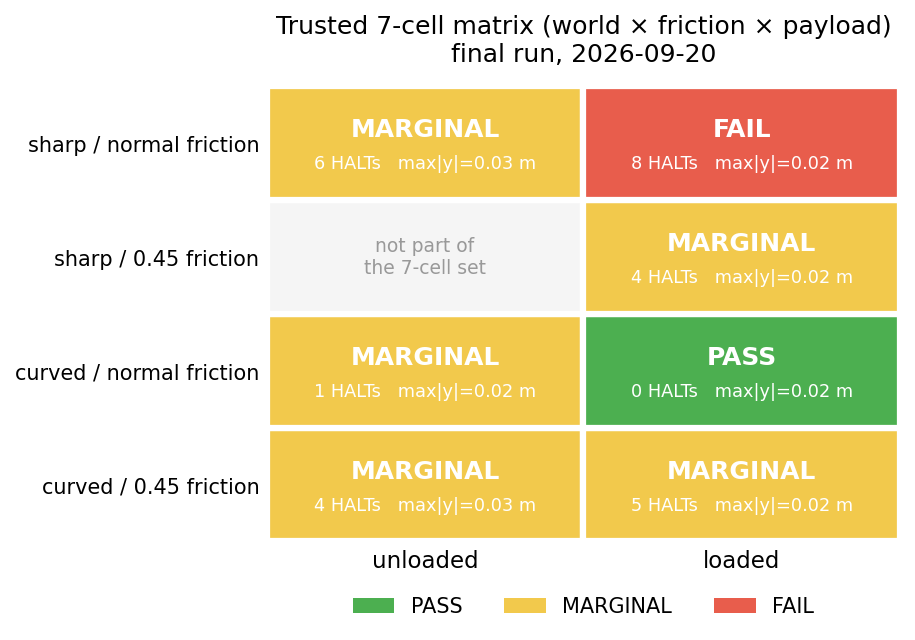

# Results

This is the current, trusted state of the project - the matrix and round-trip numbers that stand after every correction documented in
`retrospective.md`. Where a number superseded an earlier one, only the final number appears here; the history of what changed and why is in the
retrospective. Every result below follows the ground-truth methodology in `validation-methodology.md`.

## The trusted 7-cell matrix

Final run (2026-09-20), after the ramp-geometry fix, the corrected closed-loop-on-flat-ground turn procedure, the unscoped stall detector, and
the ground-truth ascent gate. One run per cell on a quiet host (real-time factor 0.994-0.999).

*Sharp-world unloaded was only tested at normal friction; sharp loaded was tested at both, since loaded climbing is where this project's friction floor actually binds.*

| Cell | HALTs | Max lateral \|y\| | Verdict |
|---|---|---|---|
| sharp / normal friction / unloaded | 6 | 0.03 m | MARGINAL - full descent, 6/6 in the regression sample |
| sharp / normal friction / loaded | 8 | 0.02 m | FAIL: HALT_THRASH on this one run - climbs and descends fully (12/12 in the sample; HALT median 2, max 6) |
| sharp / 0.45 friction / loaded | 4 | 0.02 m | MARGINAL - 12/12 in the sample |
| curved / normal friction / unloaded | 1 | 0.02 m | MARGINAL |
| curved / 0.45 friction / unloaded | 4 | 0.03 m | MARGINAL |
| curved / normal friction / loaded | 0 | 0.02 m | PASS - 12/12 in the sample |
| curved / 0.45 friction / loaded | 5 | 0.02 m | MARGINAL - 12/12 in the sample |

All 7 cells now ascend (ground-truth verified) and descend the whole ramp on the centerline (travel 5.6-5.8 m each). 1 PASS, 5 MARGINAL, 1 FAIL,
and the FAIL is a HALT-count threshold on a single run, not a completion failure - the underlying sample for that cell is 12/12 completions.
Loaded cells: 48 of 48 completions across the four loaded cells (Wilson 95% interval 93-100%). Round trips on the original geometry with the
corrected turn procedure: loaded 103% leg verification (13 total HALTs, 3 in descent, final position (1.99, +1.56)); unloaded 103% (31 HALTs, 15
in descent; final position (1.95, -0.14)). Full tables and every sample: `validation/phase8/crest_freeze/README.md`.

## Construction site round trips

The realistic construction site (gate -> laydown -> ramp 1 -> elevated level -> arc-turn -> ramp 1 down -> gate), full stack live, every leg
gated on ground truth vs. EKF displacement.

| | Loaded (100 kg, +0.1 m CG) | Unloaded |
|---|---|---|
| Leg verification | 110% | 110% |
| HALT events | 14 | 34 |
| Min stability margin | **0.463** | **0.872** |
| Final ground-truth pose | (2.12, -0.88) | (1.95, -0.10) |

The stability margin floor is bit-identical across every loaded run this project has ever logged, and every unloaded run - it has not moved
once through any of the fixes described in `retrospective.md`. Loaded leg-4 lateral drift (-0.88 m here) sits inside the characterized
distribution: 8 independent fresh-launch trials gave min 0.526 m, max 2.535 m, mean 1.263 m, sample standard deviation 0.695 m - a converged but
inherently wide spread, roughly 5x between smallest and largest trial. The drift is large enough that this project's own margining convention
(max observed excursion + 1.5 m buffer = 4.035 m) exceeds the access road's own half-width (3.05 m), which is why three props originally placed
near the gate were removed permanently rather than re-margined against more data.

## Floor 2 and the two-ramp site

Ramp-2 traversal to Floor 2, empty payload: PASS. Every leg physically verified against ground truth (0.008-0.034 m disagreement against a 0.5
m tolerance). Final ground-truth pose (76.53, 0.000, 6.675) - 7.5 m onto Floor 2 at the correct height. Max lateral drift from Floor 1's east
section onward: 0.000 m. Minimum clearance to any Floor-2 object along the real path: 1.98 m.

Floor-1-only round trips, rerun on the Floor-2 world as a zero-regression check: loaded 110% leg verification, 14 HALTs, margin 0.463, final
pose (2.12, -0.88); unloaded 110%, 34 HALTs, margin 0.872, final pose (1.95, -0.10) - identical to the pre-Floor-2 numbers above.

After the multi-ramp state-machine fix (see `retrospective.md`), a full two-ramp Nav2/MPPI-driven trip (gate -> ramp 1 -> Floor 1 -> ramp 2 ->
Floor 2 -> turn -> ramp 2 down -> ramp 1 down -> gate) completed 5 of 5 legs in both payload configurations, with `/ramp_state` correctly
labeling both climbs ASCENT and both descents DESCENT - zero mislabeled samples against ground-truth vertical velocity.

## The delivery mission

The full loaded round trip with an actual payload release: gate -> ramp 1 -> Floor 1 -> ramp 2 -> Floor 2 -> delivery pad -> release -> turn ->
ramp 2 down -> Floor 1 -> ramp 1 down -> gate, driven by `payload_delivery_node.py` watching the robot's own EKF pose and triggering release
after a 1 s dwell in the delivery zone.

**3 of 3 clean guarded runs pass.** Every leg inside its ground-truth-vs-odometry gate (worst case -0.049 m over a 27 m leg). The payload landed
on the delivery dock every time, at y = 0.72-0.88 m of the dock's 0.44-1.44 m span. HALT count (9-10) and real-time factor (~0.90) matched the
loaded full trip without the delivery event - adding the release did not destabilize anything else.

## Chassis mesh swap (public-showcase, cosmetic only)

The robot's placeholder box/cylinder visuals were replaced with real MiR100 chassis and wheel meshes (DFKI-NI's `mir_robot`, BSD 3-Clause) - see
`THIRD_PARTY_LICENSES.md` for sourcing. Only `<visual>` elements changed; every link, joint, collision shape, and inertial block in the rendered
URDF is byte-identical before and after, across every payload/detachable-payload combination this project spawns with. The regression check
(full loaded construction-site round trip, complete stack live) held the same 0.463 margin floor and the same HALT/ground-truth ranges as every
other loaded run.

## The unsecured-cargo demo mode

`cargo_mode:=loose` is a separate, opt-in demo capability, not a validated finding - no regression or validation script in this project ever
passes it, and its default (`secured`) is verified byte-for-byte identical to the project's existing fixed-joint payload behavior. It exists to
illustrate what an unsecured payload does under the same physics this project already validates, not to extend the validated matrix.

Run back to back, same spawn point, same path (a closed-loop arc-turn then ramp descent): the secured payload shows zero independent motion by
construction - it is welded into the chassis rigid body, not even a separate model to poll. The loose payload rides essentially motionless
through an entire ~128 s flat-platform turn (vertical offset locked at +0.395 m the whole time), then, once the slope component of gravity
during the actual descent exceeds static friction, slides an accelerating ~0.62 m backward and down in the final several seconds - the same
window in which the chassis's own logged pitch jumps from a steady 16.00° to 31.3° and the stability margin collapses from 0.463 to 0.147,
ending in a real safety-stack abort (`SAFETY ABORT: margin=0.147 pitch=31.3`).

This was checked for being a contact or numerical artifact rather than genuine dynamics before being treated as a result: an instrumented
re-run with a real contact sensor measured penetration depth peaking at 0.0191 mm (about 1/15,000th of the payload box's height) with all four
contact points held throughout - no tunneling. Un-rotating the payload's position by the chassis's own ground-truth orientation (correcting for
the confound that a fixed local position still looks like it's moving in world-frame coordinates as the chassis pitches) confirmed the payload
genuinely crosses the chassis's own geometric support edge several seconds before the pitch spike, then tips smoothly rather than jumping
discontinuously. The event reproduced on a second, independent run under different host-load conditions with nearly identical numbers (margin
0.097 vs. 0.098, peak pitch 33.40° vs. 33.38°). Full method: `validation/phase8/mesh_swap/cargo_demo/README.md`.

A separate, more severe finding from a full gate-to-descent run (not part of the matched comparison above): loose cargo can destabilize the
robot during the ascent, before the descent leg is ever reached, via a sudden ~1.35 m relative backward slide that drove stability margin to
its absolute floor (0.000) and triggered 29 HALT events, with the robot never recovering for the rest of a 500 s run.
