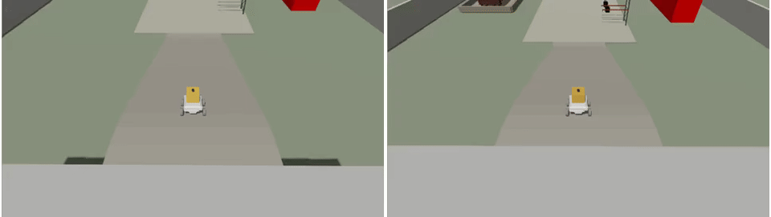
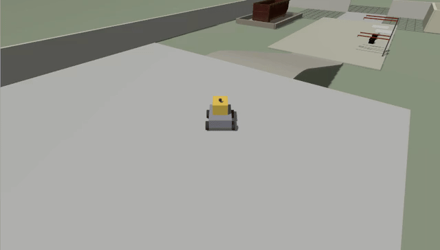

# Retrospective

Four findings in this project changed shape significantly between when they were first observed and when they were actually understood. Each
one is worth telling in full, because the gap between the first explanation and the real one is where the actual engineering happened.

## The slip metric that never once detected real physical slip

`/wheel_slip` was built in phase 6 and it works, in the narrow sense it was designed for: `|commanded - actual| / |commanded|` per wheel, read
from `/joint_states` against the commanded velocity DiffDrive itself consumes. A live test on a deliberately low-friction ramp (0.12, dropped
from the normal 0.55) produced real, repeated slip readings up to 2.08 and correctly triggered HALT every time. By that evidence, the metric was
validated.

It has a blind spot that evidence never exercised: it compares a wheel's commanded rotation rate to its actual rotation rate, and nothing else.
It has no connection to whether that rotation produces chassis displacement. A wheel spinning exactly at its commanded rate against an
obstruction it cannot climb - rather than against a slick, low-friction surface - reads as perfectly healthy, because as far as this metric
knows, it is.

This blind spot stayed invisible until two separate incidents walked straight into it. In the first, a loaded robot failed to climb the sharp
ramp world at any tested friction, with `/wheel_slip` reading exactly 0.000 the entire time - the wheels were genuinely spinning at the
commanded rate while Gazebo's own ground-truth position, queried directly, showed the robot's real world position frozen bit-for-bit for 17
seconds straight. In the second, months later, a loaded construction-site round trip froze at a ramp-top transition for the rest of a 270-second
run while `/wheel_slip` again read near zero (0.233 and 0.210 across two reproductions, both near the low end of ordinary descent slip) and the
fused EKF position kept advancing because it was integrating real, if useless, wheel rotation.

Both incidents were eventually root-caused with the same method: stop trusting the derived signals and go straight to per-wheel commanded-vs-
actual velocity from `/joint_states`, correlated against Gazebo's raw ground-truth pose. In the first case this pointed at a specific coordinate
(world x=7.119 m) that corresponded almost exactly to a sharp, unfilleted seam between two separately modeled collision boxes. In the second, it
pointed at a different seam entirely. Only after two live reproductions of the exact same failure shape did it become clear this wasn't a
software bug in `/wheel_slip` at all - it was a true architectural blind spot. No signal wired into this project, not `/wheel_slip` and not the
margin monitor, can tell "wheels rotating and chassis progressing" from "wheels rotating and chassis stuck." Closing that gap needed a
genuinely different kind of sensor: `motion_stall_detector_node.py`, which uses LiDAR scan-consistency - the only sensor on this robot that
isn't proprioceptive - to answer the question wheel-based telemetry structurally cannot.

## The breakover-angle finding that turned out to be a 5 cm authoring bug

The first of those two freezes, at world x=7.119, came with a tidy physical explanation. `base_link`'s own geometry gives the chassis almost
zero ground clearance - the wheel radius (0.12 m) nearly exactly cancels the chassis half-height (0.125 m) - and the robot froze right where
the sharp ramp world's two collision boxes meet at an unfilleted seam. A 100 kg payload, mounted forward and elevated, pressing down right over
that interference, tipping a marginal unloaded-robot-survivable case into an actually stuck one: a textbook rigid-body ramp-breakover-angle
problem. The curved world's loaded cells, with no single sharp ridge to catch on, climbed fine - consistent with the mechanism. This reasoning
held up well enough to be documented as a genuine physical/design constraint, not fixed, with a list of what would actually need to change in a
real chassis (ground clearance, payload mount height, wheelbase, filleted transitions).

It was wrong, or at least incomplete in a way that mattered. A later root-cause investigation measured every seam in every ramp world's
geometry with exact top-face corner math and found something the breakover story never anticipated: two seams per world, consistently off by
almost exactly 0.05 m, while every other seam in the same fillet chain matched to within 1.1 mm. The ramp slabs had been authored 0.05 m too
low - a flat SDF box's pose is its geometric center, and these slabs' pose.z had been set as if it were the intended top-surface height instead.
The robot's frozen front-axle position matched the theoretical first-contact distance for a 0.12 m wheel meeting a 0.05 m step almost exactly.

With the step corrected, the same 100 kg robot climbed the sharp world 24 times out of 24. The breakover-angle reasoning wasn't fabricated - the
chassis genuinely does have minimal ground clearance, and that fact was true and worth documenting - but the actual failure in front of the
investigation was a geometry authoring mistake, not the design limitation it resembled. The lesson that stuck: a plausible physical mechanism
that explains a symptom is not the same as having measured the actual geometry at the point of failure.

## The turn-harness bug

The curved world's descent legs consistently stalled a few metres into a roughly six-metre target, with anomalous final pitch readings as
extreme as 90°. The first root cause found was real and reproducible: ground-truth pose showed the robot's lateral position drifting past the
curved panel's edge during `FollowPath`-tracked descent, a genuine tip-over confirmed by a full orientation and height trace, not an estimation
artifact. The deeper mechanism behind that drift took much longer to find, and went through several wrong turns along the way - raising
`PathAlignCritic`'s weight and power did nothing, because the critic's own `offset_from_furthest` gate (default 20) exceeded this project's
entire ~15-point descent path and the critic had never activated at all on any of those tuning attempts.

Fixing that gate (dropped to 3) measurably improved cross-track tracking but did not fully close the gap, and a later, more careful experiment
exposed why: densifying the descent path and adding an explicit new cross-track critic both appeared to eliminate edge departures - zero in
twelve runs each, compared to five failures in fourteen under the existing workaround - but only because the robot was not moving. Median travel
in both "successful" arms was ten centimetres and five centimetres of a six-metre target; Nav2 was aborting the goal at fifteen seconds with the
robot still sitting at the ramp crest. A result that looks clean because nothing happened is not a result.

Recording ground truth, EKF estimate, and commanded velocity together on the actual turn maneuver finally found it: the test harness's own
open-loop 180-degree spin reliably achieves only about 90 degrees of real rotation, leaving the robot facing the panel edge rather than down the
ramp - and separately, turning in place on the curved world's crest geometry physically displaces the chassis sideways by 0.2 to 1.3 meters,
while the EKF's lateral position estimate stays at exactly 0.00 the entire time, because it fuses wheel forward velocity only and a turn in
place produces none. The controller was starting every descent already off-center and already facing the wrong way, with its own localization
confidently reporting neither problem.

The fix had nothing to do with MPPI tuning at all: turn the robot on the flat platform, closed-loop, before it ever reaches the crest. Six runs
of that procedure produced zero edge departures, with lateral drift of 2 to 4 centimetres - a result indistinguishable from a clean descent on
flat ground, because that's what it now was. Every tuning change made along the way (the critic gate, the densified path, the new critic) had
been correctly diagnosing and partially treating symptoms of a test harness bug, not a property of the robot or the controller being tested.

## The EKF-vs-ground-truth divergence

The turn-harness story above only became traceable once a more basic problem was fixed first: wheel odometry's yaw is not trustworthy under the
differential wheel speeds any turn on this robot requires, and `FollowPath`/MPPI closes its control loop against whatever odometry source it's
given. The first time this surfaced, an open-loop in-place spin reported landing within 1-4 degrees of its 180-degree target by wheel odometry,
while the robot's true heading error, measured against ground truth, was 35 to 40 degrees or worse. Trusting the IMU instead of odometry
afterward made it worse, not better - the two sensors disagreed by a further 40 degrees on one run, which ruled out "just read the other sensor"
as a fix.

Switching to a continuous closed-loop `FollowPath` arc-turn didn't help either, and this was the result that mattered most: wheel odometry
tracked a plausible-looking arc throughout, while ground truth showed the robot walking off the platform edge by 6.27 metres laterally over the
same maneuver. A controller executing its control law correctly can still drive the robot off a physical edge if the position it's being fed is
wrong - closed-loop control is not a substitute for accurate localization, it just means the controller will confidently keep correcting toward
a point that isn't where the robot actually is.

The fix was `robot_localization`'s EKF, fusing wheel odometry's velocity (not its position) with IMU orientation and angular velocity. The
distinction between fusing velocity versus position mattered in practice, not just in theory: the first attempt also fused wheel odometry's own
absolute x/y position, which re-imported the same yaw-under-slip corruption one step removed, even with an already-accurate fused orientation.
Fusing velocity only, and letting the EKF integrate position from its own corrected orientation, is what actually worked. Isolated validation
before trusting it on a real round trip showed yaw error peaking at 3.25 degrees during the exact spin that used to produce 35-40+ degrees, with
no growth in position error over distance traveled afterward.

This single fix is the reason the turn-harness bug above was findable at all - without accurate localization, there was no way to distinguish
"the controller is tracking its plan and the plan is wrong" from "the controller is confidently tracking a plan based on a position estimate
that is also wrong." Fixing the EKF didn't resolve the curved-world edge departures by itself; it made the actual cause visible for the first
time.

## Seeing what the safety stack is actually for

The four findings above are all about instrumentation catching something it wasn't originally built to catch. This one is simpler to show than to
describe: what the stability margin and HALT mechanism are actually protecting against, recorded side by side rather than argued for.

Same spawn point, same arc-turn-then-descent path, same payload mass, run back to back. On the left, `cargo_mode:=secured` - the project's
validated default - and the payload doesn't move at all relative to the chassis, because it's a fixed joint, not a separate body. On the right,
`cargo_mode:=loose` - an opt-in demo mode no validated test ever exercises - and the payload rides quietly through the flat-platform turn, then
visibly slides and tips as the ramp's slope takes over, dragging the chassis pitch past 31° (the ramp itself is 16°) before the safety stack
cancels the goal. Full numbers, and the check for whether this is genuine dynamics or a simulation artifact, are in
`validation/phase8/mesh_swap/cargo_demo/README.md`; this clip is what those numbers look like happening.

This is the mechanism from the other side: `/stability_margin` or `/wheel_slip` crossing threshold, `state_machine_node.py` forcing `HALT`,
`cmd_vel_watchdog_node.py` ramping the actuation command to zero independent of whatever MPPI profile is still nominally active, and recovery back
to whichever state HALT interrupted once the margin check clears. The loose-cargo clip above shows what happens when nothing stops the robot in
time; this one shows the mechanism that usually does.

## What this adds up to

None of these four findings were solved by the first explanation offered for them. Each one needed an independent signal - ground truth where
odometry had been trusted, per-wheel velocity where derived slip had been trusted, exact geometry measurement where a plausible physical
narrative had been trusted - before the real mechanism showed up. That pattern is the actual methodology behind `validation-methodology.md`'s
ground-truth and positive-control conventions; those weren't designed up front, they were extracted after being burned by their absence often
enough to notice the shape of the problem.
